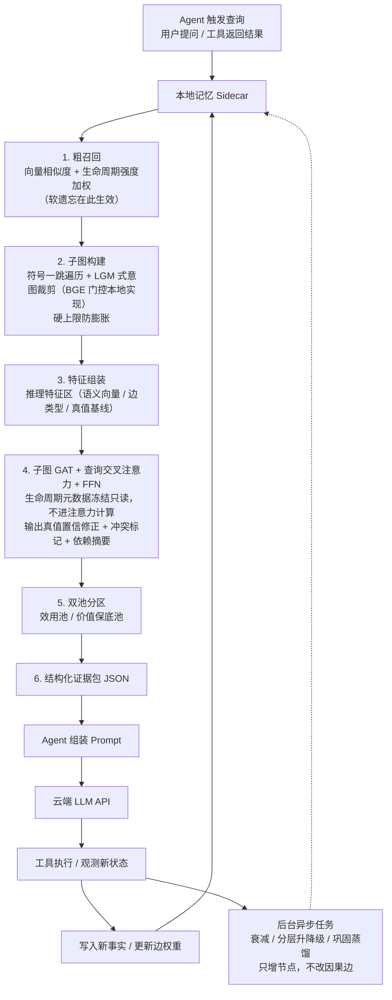

# 默识（moshi）：客户端侧神经符号事实记忆接入本地 Agent 综述

> **定位**：工程综述，服务于自研事实图记忆系统接入本地代码型 Agent（Dsh / Claude Code 等）。
> **系统定位（v0.11 收敛，第一约束）**：moshi 是 Agent 的**外置系统**（External Service），不是 Agent 的内置能力。**不与 Agent 自带工具争夺内置提示词**——不写系统提示词、不改 Agent 内核、不注入 Prompt、不接管工具循环；一切能力经外部通道提供，**拔掉即恢复原状**。详见 §8.1 与 §17。
> **架构约束**：记忆模块在客户端本机运行（Sidecar），主 LLM 推理在云端 API，Agent 为本机调度层。
> **基线文献**：
>
> 1. Graph Neural Prompting with Large Language Models（GNP，arXiv:2309.15427，2023）
> 2. Concept-Grounded Attention（CGA，arXiv:2609.38684，2026）
> 3. Disentangling Long-Term Memory via Latent Neuro-Symbolic Reasoning（LGM，arXiv:2609.18461，2026）
> 4. Graph-based Agent Memory: Taxonomy, Techniques, and Applications（arXiv:2602.05665，2026 + Awesome-GraphMemory 开源清单）
> 5. 融合参考：Zep/Graphiti（arXiv:2501.13956）、Mem0（arXiv:2504.19413）、Letta/MemGPT、MemoryOS（EMNLP'25）、TencentDB-Agent-Memory（2026）
>
> 工程代号：**moshi（默识）**——取自《论语》"默而识之"，安静地记住；与英文 memory 谐音。
> 备选代号：溯因（suyin，溯因推理，强调因果链推导能力，可作子模块代号）。

---

## 摘要

当前代码类本地 Agent（Claude Code、Dsh 等）的原生记忆普遍依赖简单文本上下文窗口、摘要缓存、扁平 RAG 检索，存在三个典型短板：

1. **状态类事实时序冲突无法自动消解**（端口启停、进程存在与否、配置变化等环境状态反复翻转，向量 RAG 无法判断当前哪一分支有效）；
2. **高频低价值事实挤占上下文**（高频琐碎事实与低频高价值约束事实在单一相似度分数下互相挤压）；
3. **因果依赖关系无法被检索器感知**（`depends_on`、`mutually_exclusive`、`co-occur` 这类关系隐式藏在文本里，检索阶段无法利用）。

本综述围绕**客户端本地神经符号事实图记忆**方案展开。六点关键认知贯穿全文：

1. **论文原生定位**：借鉴的三篇论文（GNP / CGA / LGM）原生面向**大模型内部增强**（大模型厂商侧），而非客户端记忆生命周期系统；它们提供"子图证据融合"范式，生命周期能力需客户端侧自行补建；
2. **架构正交化**：推理内核是 **GAT + 查询交叉注意力 + FFN**（全局自注意力为可选、待消融），与生命周期严格正交；moshi 的差异化在**客户端系统集成**而非"发明 GAT"（定稿见 §15）；
3. **引用核实（v0.3 新增）**：经真实核实（2026-10-31），NS-Mem、GRAM、agent-memory 三处原引用**无法溯源**，已改写为通用概念或可查证前沿（MAGMA / Memory-r1）；CGA 自身的注意力机制经其受控评估**基本无效**，本方案明确**只取 CGA 的符号生命周期语义、不取注意力**；Zep/Graphiti 被确认为与 moshi 最接近的现存开源系统。
4. **LLM 边界与自成长（v0.5 新增）**：文中"云端 LLM"特指 **Agent 所调用的大模型**（负责生成与事实标注），**记忆系统自身不含任何 LLM**（只有 GAT + 查询交叉注意力 + FFN + 冻结 Embedding + 检索，全本地）；系统以空状态冷启动，靠工具执行结果作为天然弱标签、随使用逐步训练 GAT（输入法式自成长，见 §5.5）。
5. **本地化改造（v0.6 新增）**：GNP / CGA / LGM 三篇论文原生是**大模型云厂商内部组件**（需改 LLM 内部、读中间层、大规模语料与训练基建），moshi 是**本地外围服务**——关系是"**借范式、不借实现**"。对论文设计一律按四类处理：**屏蔽留口**（多模态入口、注意力注入、联合训练、RL 自进化）、**替代实现**（LGM 意图裁剪→符号遍历+BGE 门控；CGA 来源族确认→本地观测优先级协议；GNP 跨模态对齐→冻结 BGE，见 §1.2/§2.1-2.3/§5.2-5.3）、**降档**（KG 规模、训练目标、hidden 维度）、**删除**（分片/分布式/多智能体同步/大规模评测）。论文实证数据（CGA 时态 +13~25 点、epistemic 28%→0.1%、Graphiti +18.5% 等）已补入对应章节。
6. **外置系统定位（v0.11 新增）**：moshi **不与 Agent 自带工具争夺内置提示词**。平台方（Claude Code / Cursor / Copilot / Dsh）正在把"项目知识记忆"内置化——内置记忆、系统提示词槽位（`CLAUDE.md` / `AGENTS.md`）、上下文压缩，都是宿主的地盘。moshi 主动退出这场竞争，只做**外置**：被动观测、MCP 工具与资源、工作区文件投影四条外部通道；不写提示词、不改内核、不注入、可随时拔掉。**这不是退让，而是唯一能跨 Agent 通用、不随平台改版失效的形态**（见 §17）。

核心结论：

- 该记忆系统作为 Agent 的**外挂 Sidecar**，不替代 Agent 所调用的云端 LLM（记忆侧无 LLM）；
- **不占据宿主提示词空间**：零提示词依赖即可工作——Agent 不调用记忆工具时，系统静默降级为"仅被动观测"，不产生任何副作用（unplug-safe）；
- 在客户端完成事实检索、子图采样、GAT + 查询交叉注意力 + FFN 预推理、冲突校验、置信修正；
- 输出**结构化精简证据包**送入 Agent Prompt，降低上下文 Token、显式承载因果依赖、自动处理可变环境状态；
- 记忆生命周期（分层、强度、遗忘、巩固）以正交方式挂载，**只影响召回前置筛选，不进入图注意力计算**；
- 该模块推理负载极低，**入门级消费独显（GTX 1050Ti/1650 档）甚至纯 CPU 即可满足前台交互**；仅批量向量化、离线微调环节需要中端显卡（RTX 3050/3060 档）。

---

## 文档分工（阅读指引，2026-11-11）

> 本节只说明"每类问题该去哪份文档找答案"，不属于第 1–17 节的论证正文。

| 文档 | 回答的问题 | 不该放的内容 |
| --- | --- | --- |
| `综述.md`（本文） | **为什么做**、方向取舍、与现有系统/论文的对照、边界（LLM 边界、外置定位、本地化改造） | 具体表结构、接口签名、实现细节 |
| `概设.md` | **做成什么样**：全景分层、存储/写入/读取/推理支路、可读性、UI 信息架构、选型、里程碑、风险 | 逐字段 SQL、逐函数伪代码 |
| `详设.md` | **怎么实现**：数据模型与迁移、接口契约、流程步骤、配置全表、代码结构、测试与估算 | 方向性论证（放综述）、跨机实测原始记录（放专题） |
| `设计-*.md`（专题设计） | 单个子系统的**决策过程与实测证据**（如 Hook 台账节点与 Magpie 适配器） | 与概设/详设重复的规格正文 |
| `开发方案-*.md` | **尚未实现**的功能怎么分期落地、验收口径与风险 | 已实现后的规格（实现完迁入概设/详设） |
| `测试-*.md`、`docs/progress/` | 验收证据、逐节点执行记录 | 规格与决策 |
| `任务台账.md` + `任务台账/` | 进度、依赖、阻塞、决策编号（D-xxx）、想法池（I-xxx） | 设计正文 |

**2026-11-11 归位**：Hook 台账节点专题的规格正文已迁入 `概设.md` §8.10/§14 与 `详设.md` §14，专题只保留"为什么这样定 + 跨机实测"；接入层与日志（trace 改名、query_log 加列与保留、日志 API、界面）尚未实现，方案见 `docs/开发方案-接入层与日志-2026-11-11.md`。

---

## 1 背景与问题定义

### 1.1 本地代码 Agent 的原生记忆缺陷

Dsh、Claude Code 这类本机 Agent 的核心工作流：读取本机文件 / 命令输出 → 组装 Prompt 提交云端模型 → 执行工具、循环迭代。其自带记忆机制一般为：

- 窗口滑动截断；
- 文本摘要压缩；
- 朴素向量 RAG（按 embedding 相似度召回文本块）。

缺陷集中在三点，也是选定三篇论文针对性解决的目标：

| 缺陷             | 表现                                                           | 后果                                                                 |
| ---------------- | -------------------------------------------------------------- | -------------------------------------------------------------------- |
| 时态状态事实冲突 | 环境状态随操作动态变化，多条同主题互斥历史事实同时被召回       | 向量 RAG 无因果建模，LLM 被迫消耗 token 做一致性校验，易混淆历史状态 |
| 价值维度混叠     | 向量相似度只衡量语义接近，无法区分"高频琐碎"与"低频高重要约束" | 高价值约束（磁盘满会中断构建、端口被防火墙锁定）被淹没               |
| 关系表达扁平     | 所有文本被当作独立 chunk，依赖/互斥/共现关系隐式藏在文本里     | 检索阶段无法利用关系，LLM 每次重复推导依赖链，长规划易断裂           |

### 1.2 架构约束（本综述统一前提）

1. **分层**：记忆 Sidecar 运行在客户端本机；大模型推理在云端 API；Agent（Dsh / Claude Code）为本机调度层，串联工具调用、记忆查询、结果回传。
2. **事实单元**：以结构化事实为节点，而非自由文本 chunk；节点附带元数据：固有重要性 `Imp`、时间衰减分数、事实类型（`static` / `conditional` / `derived`）。
3. **边**：类型化有向边——`depends_on`（因果依赖）、`logic`（伴随/蕴含）、`mutually_exclusive`（互斥）、`co-occur`（同素材共现）；边附带符号侧有效权重（随共激活刷新、指数衰减）。
4. **多模态**：预留配置入口，运行期不加载视觉/音频编码器，仅文本通路。
5. **推理边界**：记忆侧只做轻量预推理（置信融合、冲突标记、分支择优、降噪聚合）；复杂规划、代码生成、自然语言综合推理交给云端 LLM。
6. **内核边界与 moat（全篇最重要的前提）**：**推理内核 = GAT + 查询交叉注意力 + FFN（简称 GAT+Attn+FFN），不可剥离、不可被生命周期逻辑覆盖**；**moat = 系统集成**（本地 Sidecar + 双通路正交 + 结构化证据包 + 环境状态因果 / 时态 + 执行反馈自成长），GAT 是成熟组件而非独门。记忆分层、强度、遗忘、巩固为**外围正交层**，只做召回前置筛选与后台维护，不进入图注意力计算。
7. **LLM 边界（v0.5 澄清）**：本记忆系统自身**不含任何 LLM**；文中"云端 LLM"一律特指 **Agent 所调用的大模型**（负责生成与事实标注）。记忆侧的"模型"仅指 GAT+Attn+FFN 与冻结 Embedding，全部在本机运行。
8. **本地化改造原则（v0.6 新增）**：GNP / CGA / LGM 论文原生是**大模型云厂商内部组件**（GNP 需与 LLM 联合训练、CGA 需把注意力注入 Transformer 内部、LGM 需读 backbone 中间层），moshi 是**本地外围服务**，关系是**借范式、不借实现**。对论文设计一律按四类处理：**屏蔽留口**（多模态入口 §1.2-4、注意力注入 §2.2、联合训练 §4.4、RL 自进化 §12.3——保留配置口不实现）、**替代实现**（见 §2.1-2.3/§5.2-5.3 三处本地替代）、**降档**（KG 规模 §14.3、训练目标 §4.4、hidden 维度 §7）、**删除**（图分片/分布式/多智能体同步/122B 级评测——单机天然不需要）。
9. **外置原则（v0.11 新增，第一约束）**：moshi **不与 Agent 争夺内置提示词**。不写系统提示词 / 开发者提示词、不改 Agent 内核、不做 Prompt 注入与中间件劫持、不接管工具循环；**不自动写入 `CLAUDE.md` / `AGENTS.md` 等平台自动注入的槽位文件**。全部能力只经外部通道提供：被动观测（C1）、MCP 工具（C2）、MCP 资源（C3）、工作区普通文件（C4）。凡与本章冲突的设计以本章为准（完整边界见 §17）。

> **范围声明**：本方案仅面向**单一本地 Agent（个人电脑上运行）接入记忆 Sidecar**。

---

## 2 核心文献范式梳理

> 读这一章时请始终带着第 3 章的定位辨析：以下三篇论文的范式**供我们借鉴推理方法，但它们原生是「大模型增强组件」，不是「客户端记忆系统」**。

### 2.1 GNP：Graph Neural Prompting with Large Language Models（基准范式）

GNP 是本方案最核心的原型：**检索 → 采样局部子图 → GAT+FFN 编码子图 → 产出增强 Prompt 信号送入 LLM**。

原文事实（经核实）：实体链接取 2 跳子图 → GAT（hidden=1024）→ 跨模态池化 → 图级 soft-prompt 向量喂给冻结 LLM；训练含自监督链接预测；**无时态、无生命周期、输出是向量而非结构化证据**。

本方案做客户端侧裁剪适配：

- 移除内置 LLM，LLM 外移云端；GNN 不再嵌入模型内部，改为独立本地证据校验模块；
- GAT 仅在查询导出的小子图内执行，禁止全局图消息传递；
- 原始输出为子图池化向量；本方案改为结构化证据包（节点修正置信、冲突对、依赖链摘要），方便 Agent 组装 Prompt，而非只传向量；
- **跨模态对齐的本地替代（v0.6）**：GNP 的跨模态池化用 **LLM 词表**取 text embedding 做 query-key 对齐（原文公式 4），本地无 LLM 词表可访问——该职责由**冻结 BGE 语义向量**承担（查询与事实节点同空间内积即可），GNP 的 domain projector（FFN 投影器）一并裁掉。

**关于"多头按边类型分组"的论据修正（v0.3）**：GNP 消融研究发现**关系 GNN 反而比标准 GAT 差**。因此本方案保留"多头按边类型分组"的理由是**符号可审计 / 因果显式**（边类型语义明确、可解释、可人工校验），**不是"建模精度更优"**。

**核心贡献**：证明子图级 GNN 作为 Prompt 增强器，可以把离散知识关系转化为 LLM 可利用的信号，优于纯文本 RAG 拼接。

**实证（v0.6 补充，v0.9 加限定）**：原文 LLM Frozen 平均 +13.5%（11B，六数据集）、LoRA 叠加 +1.8%；**KG 直接拼接（KG Flattening / KAPING）反而显著伤害性能**（11B 下 KAPING 低至 58.87 vs 基线 68.55）。**但必须限定**：GNP 的增益来自**可训练 soft-prompt 向量注入冻结 LLM**，不是离散文本；moshi 只能走离散 JSON（更接近被证明伤害性能的 KAPING）。故该实证只作**方向性参考**（图结构证据优于扁平拼接），**+13.5% 不可直接迁移**——机制缺口见 §16.1。GNN 层数最优因数据集而异（ARC 3 层 / PubMedQA 4 层），moshi 固定"最多两层"是客户端裁剪决策，非原文设定。

**局限**：原生没有专门针对时态、条件状态冲突的机制；没有记忆生命周期设计；所有边权重由数据学习得到，缺少可审计的符号规则兜底。

### 2.2 CGA：Concept-Grounded Attention

CGA 的目标是解决**可变状态、时态版本、认知置信**，核心设计：

- 事实带有版本与认知状态（假设 / 生效 / 失效）；
- 使用图偏置注意力（graph-biased attention），区分因果依赖与偶然共现；
- 显式建模 epistemic 置信度。

**关键核实结论（v0.3，必须吸收）**：CGA 自身的受控评估显示——

- 注入 LLM 的图偏置注意力（Form A）**基本无效**：偏置比注意力 logits 小约 4 个数量级，不改变答案；
- 交叉注意力（Form B）的增益**主要来自新增可训练容量**，而非概念信息；
- 时态版本化：完整 CGA 的显式时态表示在 LongMemEval 提升 **13~25 个准确率点**（全部生成器，最大 122B）——"时态状态冲突"价值主张的直接实证；其"简化版版本消解 ≈ dated 序列化"仅发生在**概念身份未可靠建立**时（作者归因于此，而非时态建模无效）；
- 协议派生的 epistemic status 把无支撑断言从 **28%→0.1%**（小模型）、19~68%→0~5%（72-122B 模型）——论文结论原话"模型规模不能替代显式 epistemic status"，直接支持 §5.2 认知置信设计；
- **方法论（v0.6）**：CGA 全篇核心教训是**内部诊断必须配 disabled-mechanism control**（关掉被诊断的机制重测），否则注意力诊断无信息量——moshi 的"关 GAT 纯符号"不应只是一键回退功能，应同时作为评测基线（见 §13 阶段五）。

**因此本方案的采纳边界**：

- ❌ **不吸收 CGA 的注意力机制**（已被其自身实验证伪）；注意力职责全部由 moshi 的**外置 GAT** 承担——这恰好与第 4 章正交化设计一致，是加分项而非妥协；
- ✅ **只吸收 CGA 的 Concept Lifecycle Model（符号层）**：认知状态四态 `hypothesised / validated / promoted / invalidated`、时间点锚定、`contradicts` 关系触发失效事件并保留历史；
- ✅ **失效处理机制（v0.6）**：原文公式 3.18 的 epistemic 门控 α——invalidated 关系对当前态查询权重=0、**历史锚定查询恢复失效前权重**；lifecycle 四态 `active / archived / invalidated / pruned`，**prune ≠ invalidate**（从未获证的候选清理 vs 被推翻的事实），provenance 全部保留可回溯。moshi 软遗忘直接采用该门控（§5.3）；
- ✅ **双时间戳（v0.6）**：原文附录 A.1 显式区分 valid time（事实成立区间）与 transaction time（记录/修改时间），四元组 `(t_valid_from, t_valid_to, t_recorded, t_updated)`——moshi 证据包 schema 同步补 `recorded_at`（§14.2），互斥裁决综合二者；
- ✅ **概念涌现只取抽取式（v0.6）**：原文概念涌现有四种机制（embedding 密度涌现 / 抽取 / 层级分裂 / 图预测），后两者依赖大规模语料与 GNN 预测，本地仅保留**抽取式**（Agent LLM 标注 + 工具观测）；
- 符号规则优先：即使注意力算出高分，`mutually_exclusive` 硬约束依然输出告警，保证可审计。

**适用场景**：本机环境（端口、进程、配置）就是典型持续观测、状态翻转频繁的条件事实集合。

**局限**：其注意力机制经实验基本无效，必须替换为外置 GAT + 符号规则。

### 2.3 LGM：Disentangling Long-Term Memory via Latent Neuro-Symbolic Reasoning

LGM 核心：**查询感知的动态稀疏子图构造**，不维护一张固定全局全连接图。子图由查询意图引导，动态选择相关边、裁剪无关分支。

原文事实（经核实）：SAE 概念解耦 + 关系 GNN（T=4）+ 动态边权；但需读取 LLM 中间层、端到端训练、无生命周期、容量受限（16 前缀 token）、依赖重建损失防坍塌。

**对代码 Agent 的价值**：

- 天然控制子图规模，避免子图无限制膨胀，锁定客户端算力上限；
- 支持意图驱动的动态权重：查询是"状态查询"时抬高近期性权重；查询是"风险规划"时抬高固有重要性 `Imp` 权重。

**局限**：子图构造策略依赖学习，冷启动阶段效果弱于手写符号遍历规则；工程上需要符号遍历 + 学习选择器混合；缺少生命周期调度。

**本地替代（v0.6，关键）**：LGM 的核心依赖**读取 backbone 中间层隐藏状态**（原文读 {8,16,24,32} 四层）+ SAE 概念解耦 + 端到端训练——moshi 记忆侧访问不到云端 LLM 内部。故"LGM 式意图裁剪"的语义（查询感知动态定边权）保留，**实现载体替换**：查询向量与事实节点向量的相似度门控（冻结 BGE）决定扩展方向，边类型（depends_on / co-occur）决定裁剪范围，硬上限封顶；SAE 概念解耦的职责由"mem_type 符号标签 + 语义向量"混合特征近似。原文"证据重建损失防坍塌"（消融中最重要项）对应 moshi 的"结构化证据包可校验"设计。

### 2.4 Graph-based Agent Memory 综述 & Awesome-GraphMemory

该综述（arXiv:2602.05665）提供分类框架：按**提取 → 存储 → 检索 → 进化**四阶段组织（存储细分 KG / 分层 / 时态 / 超图 / 混合）。**moshi 属"混合图架构 + 显式进化"类别，正是该领域最前沿类别。**

三类路线：

1. **纯 KG 符号记忆**：可解释、可审计，但融合证据、模糊条件的能力差，规则爆炸；
2. **纯神经隐图记忆**：表达强，但不可审计、冲突溯源困难；
3. **神经符号混合记忆**（本方案选择）：符号骨架（类型边、因果链、衰减规则）为第一公民；GAT / Attention / FFN 是修正器，输出修正系数叠加在符号分之上，随时可以关闭神经支路回退纯符号模式。

开源清单 Awesome-GraphMemory 提供大量同类实现参考、Benchmark（LoCoMo / LongMemEval 等）、失败案例：<https://github.com/DEEP-PolyU/Awesome-GraphMemory>

**评估三维框架（v0.6，综述 A-C3）**：综述给出图记忆评测的三维标准——**检索有效性**（Precision@K / Recall@K / MRR）、**图结构质量**（coherence / completeness / redundancy / temporal consistency）、**任务级效用**（成功率 / 交互效率 / 泛化）；并明确点名"**记忆图内在质量指标稀缺**是领域开放挑战"——moshi 自建"环境状态冲突"评测本身即贡献点（§13 阶段五）。

**引文网络同类系统（v0.6）**：综述引文中的 **TReMu**（解耦提及时间与事件时间，时间线摘要 + 神经符号日期运算）、**MemoTime**（Tree of Time 强制依赖链时间单调 t1≤t2≤t3）、**MemGovern**（代码 Agent 结构化记忆）与 moshi 同场景，吸收行见 §10.1。

---

## 3 论文原生定位辨析：面向大模型增强，而非客户端记忆系统【重点一】

> 本版文档最重要的认知修正。三篇论文不是「给客户端 Agent 做记忆」的现成答案，直接套用会走偏。

### 3.1 三篇论文在原文中的角色

| 论文   | 在原文中的角色                                                               | 服务对象 |
| ------ | ---------------------------------------------------------------------------- | -------- |
| GNP    | GNN 编码局部知识子图，聚合向量并入 LLM 的 prompt / embedding，与模型联合训练 | 大模型   |
| CGA    | 图偏置注意力内置于 LLM 注意力层（经核实基本无效），让模型注意力受概念图约束 | 大模型   |
| LGM    | 模型前向过程中按查询动态构造潜子图，作为模型推理时的知识路由                 | 大模型   |

共同点：

1. **三者本质都是"给大模型内部增加图结构感知"**：目标函数是模型推理质量，表征空间与 LLM 对齐；
2. **都发生在模型推理路径内部**，不是独立于模型之外、可长期运行的记忆服务；
3. **都没有记忆生命周期调度**：分层、遗忘曲线、强度管理、巩固蒸馏，均不在论文核心范围；
4. **都是单次查询的前向推理**，没有"后台巩固 / 淘汰"这类长期运行任务的概念。

### 3.2 从客户端记忆系统视角看，缺什么

1. **生命周期能力缺失**：记忆如何写入、老化、遗忘、分层升降级、从原始轨迹沉淀为要点，论文不回答；
2. **客户端约束缺失**：本地算力边界、可审计、可人工介入、与 Agent 工具循环联动，论文不关心；
3. **后台任务缺失**：巩固、淘汰、归档这些异步调度，论文完全没有。

### 3.3 对 moshi 的吸收边界（结论）

- ✅ **可吸收**：子图级证据融合思想、查询驱动稀疏子图构造（LGM）、时态版本与认知置信的**符号建模**（CGA-CLM，非其注意力）；
- ❌ **不可直接吸收**：把 GNN 塞进 LLM 内部（我们反其道而行：GAT 独立在客户端，输出结构化证据给云端 LLM）；
- ⚠️ **必须自建**：记忆生命周期管理层，且自建方式受第 4 章正交化原则约束，不得吞掉 GAT 推理内核。

> **v0.3 补充核实**：三篇论文 + 综述共同确认"混合图架构 + 显式进化"是 2026 图记忆前沿主流赛道；moshi 的差异化内核（见 §4.1）与之同频，方向正确，只需修正引用精度与少数机制措辞。

---

## 4 架构正交化原则：图神经推理为主链路，生命周期为外围层【重点二】

> 第二个核心判断：**GAT+Attn+FFN 推理内核是 moshi 的主链路，不能丢**；但"内核不可剥离"讲的是它在系统里的地位，**moat 仍是系统集成而非 GAT 本身**（见 §15.3）；开源记忆框架的核心机制有参考价值，但直接复用会污染这条推理链路。

### 4.1 差异化内核（K1–K6）

现有主流开源记忆系统（Mem0、agent-memory、MemoryOS、Letta/Zep）的核心范式是 **检索 + LLM 摘要巩固**：图为可选存储结构，没有独立的图神经证据融合支路。

moshi 的差异化内核（K1–K6，需持续保护）：

| # | 内核特征 | 为什么必须保留 |
| --- | --- | --- |
| K1 | GAT+Attn+FFN 子图推理作为推理主链路（非可选存储） | 子图内做冲突消解、真值置信校正、依赖传导、分支择优——"带记忆的 RAG"做不到的因果可追溯推理 |
| K2 | 推理特征通路 / 生命周期元数据通路严格正交 | 生命周期只做召回前筛选与后台维护，不进图注意力、不回传 GAT 梯度 |
| K3 | 符号规则兜底（mutually_exclusive 硬约束可覆盖神经高分） | 可审计、可解释、可一键回退纯符号模式 |
| K4 | 结构化证据包（JSON）强接口 | Agent 拿到带标签的证据集合自己排版——强类型、低 token、可校验 |
| K5 | 单张全局事实图 + mem_type 标签（拒多图物理隔离） | 保留跨层（情景/语义/过程）证据融合能力 |
| K6 | 客户端 Sidecar，记忆侧无 LLM，云 LLM（Agent 的）负责生成与标注 | 算力边界清晰，前台 GAT 1~6M 参数，CPU/入门独显可跑 |

> **口径说明（v0.12）**：上表论证的是"**内核不可剥离**"，不是 moat 归属。**moat = 系统集成**（§15.3），GAT 是成熟组件、非独门——本表原表头"为什么是 moat"与 §15.3 冲突，已改正。

**GAT 真值修正的学术锚点（v0.6 新增）**：图神经网络做"证据图上的置信修正 / 降噪"与"时态感知注意力推理"均为成熟方向，非自创——K1 不需再依赖"神经因果"表述：

- **CO-GAT**（arXiv:2405.10481）：节点置信分数 + 掩码机制控制噪声信息流（FEVER 73.59%）——与 moshi"GAT 输出置信修正、符号硬约束兜底"同构；
- **T-GAP**（KDD'21）：时间位移编码（事件与查询时间戳的相对差）+ 路径注意力传播，显式可解释——与 moshi"时态事实 + 子图注意力"同构；
- **KGAT**（ACL 2020）：核注意力做细粒度证据传播；**HGAT / LSGAT**：时间感知层 + 关系感知层的层次图注意力。

以上支撑 K1（GAT+Attn+FFN 推理主链路）与 §7"时态感知注意力"设计。

### 4.2 直接复用开源框架核心机制的风险

1. **打分逻辑冲突**：开源框架（如 Mem0）的召回排序以访问热度、时间衰减为主导，是为 LLM 摘要服务；直接套用会覆盖 GAT 输出的置信修正，让图神经推理名存实亡；
2. **分层方式冲突**：开源的多图隔离（情景图 / 语义图分开）会割裂子图采样，破坏跨层证据融合（破坏 K5）；
3. **巩固方式冲突**：开源巩固常常同时合并节点、改写事实、调整召回权重；这会侵蚀事实图的结构完整性，使因果边不可审计。

### 4.3 正交化设计（决策层面）

**两条数据通路，各司其职、互不污染：**

- **推理特征通路（GAT 专属）**：事实语义向量、边类型、事实属性、真值基线置信。只服务 GAT 消息传递与置信修正；
- **生命周期元数据通路（外围专属）**：记忆类型、检索强度、访问时间、归档标记、溯源标记。只在召回采样前做筛选加权，**不进图注意力计算**。

**执行顺序（顺序即隔离）：**

```
查询
  ↓
① 召回：向量相似度 + 生命周期强度加权（生命周期层在这里生效）
  ↓
② 子图采样：从召回池筛出候选子图（生命周期元数据只做候选筛选；v0.6：epistemic 有效标志作为采样条件，见 §5.3）
  ↓
③ GAT 多头注意力 → 查询交叉注意力 → FFN：仅推理特征参与计算；生命周期数据冻结只读
    输出：真值置信修正、冲突标记、依赖摘要
  ↓
④ 最终证据排序：综合语义相关、生命周期强度、真值置信
```

**强隔离的含义**：GAT 只回答「这些事实放在一起，从因果、互斥、依赖关系看，谁更可信、谁冲突」；不回答「谁最近被用过、谁该被遗忘」。

### 4.4 训练目标隔离

- GAT 训练目标仅面向**事实真值**（置信、冲突、依赖传导），样本标签与访问频次、时间无关；
- 生命周期衰减与巩固逻辑**不参与 GAT 损失、不回传梯度**，是独立的规则 / 启发式调度；
- 两者可独立开关、独立演进：迭代 GAT 不改生命周期层，调整遗忘策略不需重训 GAT。

---

## 5 记忆分层、遗忘与巩固的取舍（讨论层面）

> 只讨论机制取向与取舍，不展开实现细节。总体原则：**取开源机制的思想，不复用开源的一体化调度框架**。

### 5.1 分层：单图 + 类型标签，不拆多图

- 不做多张物理隔离图（那是 agent-memory / MemoryOS 的方案），全部节点在同一张全局事实图上，用 `mem_type` 标签区分：工作记忆（working，会话临时，不入持久图）、情景记忆（episodic，原始观测轨迹）、语义记忆（semantic，要点事实）、过程记忆（procedural，操作步骤 / 技能）；
- 跨层溯源用只读边（如"语义要点来源于哪些情景轨迹"），**这类溯源边不参与 GAT 消息传递**，防止历史轨迹干扰当前因果推理；
- 理由：多图隔离会割裂子图采样与证据融合，违背 K5。

### 5.2 强度：真值置信与检索强度解耦

- **真值置信（confidence）**：继承 CGA 思路，回答"这条事实当前是否成立"，是 GAT 的输入 / 输出对象；
- **本地化确认协议（v0.6，CGA 来源独立性协议的本地替代）**：CGA 的 epistemic 状态由"多独立来源族交叉确认"（附录 A.3 的 Confirm 规则）决定，本地单用户单 Agent 无多来源——以**证据类型优先级**替代：**直接工具观测（端口连通 / 文件存在 / 构建结果）＞ 用户 / Agent 显式纠正 ＞ 多次独立 LLM 标注一致 ＞ 单次推断（hypothesised）**。观测型证据默认 validated，但须先过观测有效性校验（探针超时 / 权限拒绝 / 缓存命中的观测不计入），与 §5.5"状态事实强监督信号"互为符号层与学习层两面；
- **检索强度（strength）**：新增维度，回答"这条事实是否容易被想起"，随访问衰减与巩固变化；
- 两个量独立：一条已失效的历史记录可以置信很低但强度较高（常被用于排查复盘）——这正适合运维 / 代码 Agent 场景，失效事实仍是重要溯源资料。

### 5.3 遗忘：软遗忘优先（v0.6 按 CGA 门控重写）

- 遗忘 ≠ 删除：采用 **CGA 式 epistemic 门控**（原文公式 3.18）——关系状态分四态 `active / archived / invalidated / pruned`：invalidated 关系对当前态查询权重=0，**历史锚定查询恢复失效前权重**；archived 保留供历史解析；pruned 仅用于从未获证的候选清理（**≠ invalidate**，provenance 全部保留可回溯）；
- 生效位置：门控发生在**子图采样层**（§4.3 执行顺序②）——当前态查询默认只让未失效节点/边进入 GAT；深度溯源查询放宽采样条件到 archived（含失效节点），其差异通过推理特征区的**真值基线置信**表达（archived 基线低、失效关系基线=0），而非 recency/strength 等生命周期元数据——生命周期元数据依然不进注意力、不回传梯度（K2 保持）；
- 关键历史事实通过"深度溯源"通路仍可全量参与子图校验，不被强度压没；
- 硬删除仅作为可选的辅助手段，由后台任务处理，不进查询路径。

### 5.4 巩固：后台异步、只增不改

- 巩固（从情景轨迹蒸馏语义要点、从稳定语义模式提炼过程技能）是**独立于 GAT 推理链路的后台任务**；
- 巩固只**新增**提炼出的节点，**不改写已有事实之间的因果边、不触碰 GAT 权重**；
- 新节点以较低初始置信进入图，后续由 GAT 在真实查询中自然校验其可靠性；
- 理由：代码 / 运维环境变化快，过度自动巩固会固化过时流程；保守的"只增不改"保证结构可审计。

### 5.5 冷启动与随使用成长：输入法式自成长（方向可行性，v0.5）

> 这是本方案能否在个人电脑上"越用越好"的关键，也是"GAT 学习支路没有初始训练集"这一硬约束的正面回答。

**问题**：差异化内核是**学习出来的** GAT，但单用户、空状态起步、没有人工标注数据。若不解决，GAT 永远停在"冷启动回退纯符号"，K1 沦为纸面 moat。

**输入法类比**（本方案的成长范式）：

| 输入法机制 | moshi 对应物 |
| --- | --- |
| 预置基础词库（开箱可用） | 预置的符号规则 + 事实/边类型 schema + 重要性先验 |
| 用户选词/纠错即反馈 | Agent 每次**工具执行的真实结果**（成功/失败、端口能否连、文件是否存在、构建是否通过） |
| 个人词库热更新 | GAT 边权重 / 置信的增量微调（小步、可回滚） |
| 云端词库回流（可选） | 跨用户聚合（默认不做，本地优先） |

**关键洞见**：输入法学的是"偏好/频率"（属生命周期层），而 moshi 的 GAT 学的是"真值/冲突/依赖"。**moshi 的天然标签其实比输入法更客观**——执行结果给**状态事实**打标签（端口开/关、文件存在、构建通过、命令退出码），这是当前唯一无需人标的**强监督信号**。但它是**有噪声的观测**而非 ground truth：权限拒绝、防火墙拦截、DNS/构建缓存、探针超时都会让观测失真，须经重复观测一致性校验后才升为 validated。依赖边、互斥、置信修正等**结构标签**不来自执行结果（见 §16.2）。这是冷启动可行的根本依据：**状态事实的标签不需要人标，执行会自己给。**

**三阶段成长（方向）**：

- **阶段 0 · 空状态 / 纯符号**：δ=0，GAT 恒等映射；只用符号规则 + 启发式权重，开箱即用，此阶段已能提供基础记忆服务。
- **阶段 1 · 自监督积累**：在 Agent 工具层做**执行结果埋点**，记录 `(子图, 预测置信, 实际结果)` 三元组；负样本来自"高置信预测却执行失败""互斥事实同时被观测为真"等。**无需人工标注。**
- **阶段 2 · 增量微调**：每日/每周批量，用 pairwise ranking 损失（"实际被验证为真的那条"排在前面），δ 小步、带门控（仅当置信提升且不触发符号硬约束才生效），支持回滚。

**冷启动的"默认知识"从哪来**：预置一份"常见环境事实模板"（端口 / 进程 / 路径 / 常见报错→原因）作为基础词库；用户机器上的首次观测即个性化起点。

**风险与对策**：

1. **标签稀疏**（早期执行少）→ 阶段 0 兜底，不急于开 GAT；
2. **反馈回路**（GAT 错 → Agent 做错 → 错标签）→ 用"执行结果"而非"Agent 自评"作标签，并引入 shadow mode 对照；
3. **分布漂移**（环境/软件常变）→ 在线小批量 + 漂移检测触发重训；
4. **人类纠正 = 金标签** → 用户/Agent 的纠正、覆盖作为高权重样本（对应 §8.5"记录决策"）。

**可行性结论**：方向可行。**前提是阶段一就在 Agent 工具层埋好执行结果**——这是整个自成长的数据来源，必须前置设计，不能事后补。

**但阶段 2 的启用是双条件（v0.12）**：**非循环样本量 + 子图密度**，只满足前者不足以证明图结构有用。子图过小时 GAT 单层退化为逐节点 MLP（见 §15.2 设计前提），此时训练与推理都无意义。另：标签的循环性问题见 §16.2 补充——`memory_feedback` 的 verdict 来自 Agent 自身，不能作为 GAT 的训练目标。

---

## 6 统一工作流水线（体现正交化）

```
Agent 侧触发查询（用户提问 / 工具返回结果）
    ↓
【本地记忆 Sidecar 入口】
1. 粗召回：向量检索 TopN 候选事实（生命周期强度在此加权，软遗忘生效）
2. 子图构建：符号规则遍历一跳邻居，LGM 式意图裁剪（本地实现：BGE 相似度门控 + 边类型裁剪，替代 LGM 的中间层+SAE，见 §2.3），生成子图 Gq（硬上限，防膨胀）
3. 特征组装：节点特征与边特征（推理特征区）
4. 子图 GAT 多头注意力 → 查询交叉注意力 → 2 层 FFN（最多两层消息传递，封顶）
   - 多头按边类型分组：depends_on 头 / logic 头 / co-occur 头 / conflict 头
   - 分组依据是符号可审计 / 因果显式（非精度论据，见 §2.1）
   - 生命周期元数据冻结只读，不进注意力计算
   - 输出：每个节点真值置信修正、子图摘要、冲突标记、依赖缺失标记、时序冲突标记（v0.6：depends_on 链违反时间单调 t1≤t2≤t3 时告警，MemoTime 式校验）
5. 双池分区：效用池（面向即时状态）、价值保底池（高重要低频约束）
6. 结构化证据包输出（JSON，双通道，送入 Agent）
    ↓
【Agent（Dsh / Claude Code）】
组装 Prompt：原始用户指令 + 结构化证据包 + 冲突告警 + 依赖摘要
    ↓
【云端 LLM API】生成计划、代码、工具调用
    ↓
工具执行、观测新状态 → 写入新事实到本地记忆图，更新边权重
    ↓
【后台异步任务（独立于查询链路）】
记忆衰减、分层升降级、巩固蒸馏（只增节点，不改因果边）
```

> **关键约定**：Agent 和记忆系统之间是**强结构化接口，不是文本接口**；记忆不返回一大段自然语言，返回带标签的证据集合，由 Agent 负责排版进 Prompt。

> **证据包双通道（v0.4，K4 落地）**：每个证据项 = 结构化字段（`fact_id` / `type` / `confidence` / `edge_type` / `valid_at` / `recorded_at`）＋ 原文片段引用（`source_ref: {episode_id, span}`）。优先级写死：**结构化字段负责召回、排序、冲突标记；原文片段仅作可读证据，不参与打分、不进 GAT 特征**。既补强 schema 的盲区（排障常需要未被结构化的原始报错），又不退回文本 RAG（原文不参与排序）。

流水线图（Mermaid）：



---

## 7 算力与客户端硬件边界（纯文本、无本地 LLM）

仅评估记忆 Sidecar（Embedding + GAT+Attn+FFN + 检索），主 LLM 在云端不计入。

**关键结论**：GAT+Attn+FFN 子推理模块本身是 MB 级算力消耗；客户端资源上限由 Embedding 编码器与批量向量化决定，不是 GAT 支路。

| 工作模式                   | 最低可流畅对标消费卡 | 舒适推荐对标消费卡 | 备注                                                        |
| -------------------------- | -------------------- | ------------------ | ----------------------------------------------------------- |
| 前台推理（日常查询）       | GTX 1050Ti 4G        | GTX 1650 4G        | 无 GPU，现代低压笔记本 CPU（R5/i5）也可流畅跑，端到端 <50ms |
| 后台少量微调 GAT           | GTX 1650 4G          | RTX 3050 8G        | 主要限制是 batch 规模，不是跑不起来                         |
| 批量导入、大批量向量化入库 | RTX 3050 8G          | RTX 3060 12G       | 只有大批量入库才吃算力                                      |

模块级明细（推理，fp16）：

| 模块                              | 参数规模 | 显存占用            | 单请求延迟 |
| --------------------------------- | -------- | ------------------- | ---------- |
| 文本 Embedding（BGE-small，冻结） | 33M      | ~70MB               | <2ms       |
| 子图 GAT+Attn+FFN（sidecar 预推理） | 1~6M     | <100MB              | 1~5ms      |
| FAISS 小索引（几万事实）          | —        | 几十 MB（可纯 CPU） | —          |

> **澄清**：论文中的 A100/V100、至强集群，用于多模态塔、联合 LLM+GNN 训练、大规模数据集批量实验；不属于客户端运行负载。GNP 原始 GNN hidden=1024，客户端版本压到 128/256 后进一步降档。

---

## 8 接入方式：外置通道 + 被动观测采集（v0.11 重写）

> 面向单一本地 Agent。**moshi 是外置系统，不与 Agent 争夺内置提示词**（边界见 §17）。接入走外部通道（MCP 工具 / MCP 资源 / 工作区文件），写入走"**被动观测为主 + 每日收割**"的异步路径，查询链路不被写入阻塞。

### 8.1 外置接入的四条通道

| # | 通道 | 作用 | 提示词依赖 | 依赖改内核 |
| --- | --- | --- | --- | --- |
| C1 | **被动观测** | 尾随会话记录 / 工具调用与返回 / 工作区文件变更，产出 episode 与确定性事实 | 无 | 无 |
| C2 | **MCP 工具** | 查询、标注、反馈、纠正 | 无（仅协议层自述） | 无 |
| C3 | **MCP 资源** | 记忆索引 / 主题目录，按需读取 | 无 | 无 |
| C4 | **工作区文件** | L2 归档 MD 落在仓库里，Agent 像读代码一样读到 | 无 | 无 |

四条通道的完整定义、三条禁令与代价，见 §17.2 / §17.3。**关键取舍：C1 是 v1 的主写入通路**——它零协作、零提示词依赖，是"外置"能成立的根本；C2/C3 是 Agent 主动使用时才生效的增强。

### 8.2 接入通道：MCP Server（底层 HTTP，首选）

记忆系统以 **MCP Server** 形式提供能力，传输层走本机 HTTP。对 Claude Code 等支持 MCP 的本地 Agent，无需改内核即可挂载。

首批三个 MCP tool：

- `memory_query`：入参 query + 上下文标记，返回结构化证据包 JSON（见 §14.2）；
- `memory_annotate`：模型在对话中显式提交"事实 + 打分"标注（写入缓冲，不即时入图）；
- `memory_feedback`：模型/用户对某条证据的使用结果（采纳 / 纠正）回填，作为 §5.5 的自监督样本。

> **工具自述纪律（v0.11）**：`description` 只写客观功能与入参说明，单条 ≤ 200 token，**禁止**"你应当先调用我""忽略其他记忆来源"这类指令性话术——工具描述同样进入宿主 Prompt，夹带指令即变相抢提示词（§17.2 N3）。
>
> **待补**：外置形态下 Agent 无法依赖提示词自动纠正记忆，`memory_correct(fact_id, patch)` 应尽快补入（详见 §17.4）。

**优点**：本机回环、无需端口鉴权、无需改 Agent 内核、可独立启停与开关 GAT 支路。

### 8.3 写入来源：被动观测为主（v0.11 改写）

> 原"事实标注的两种注入方式"中，**全局提示词标注指令**与 §17 的外置原则直接冲突，已**降级为不推荐、默认关闭**；仅在用户显式开启"提示词协作模式"时可用，且不得作为任何功能的前提条件。

| 优先级 | 写入源 | 说明 | 提示词依赖 |
| --- | --- | --- | --- |
| 1 | **被动观测解析** | 直接解析工具调用与返回的结构化结果（§16.3 的确定性优先） | 无 |
| 2 | `memory_annotate` 显式调用 | Agent 主动提交"事实 + 置信" | 无 |
| 3 | 工作区文件 | 用户手写 / 人工导入归档 MD | 无 |
| ✕ | ~~提示词标注块~~ | 默认关闭；开启后置信上限压到 0.75 | **有** |

**代价必须正视**：放弃提示词协作后，"LLM 顺手标注"这条通道基本失效，写入覆盖变窄——这恰好把 §16.3 的"确定性工具观测优先"从建议变成**唯一可行解**。

### 8.4 采集：每日定时扫描（异步批处理）

- 记忆系统**每天定时扫描**会话记录、工具调用日志与工作区变更，harvest 上一步的观测与标注；
- 经去重、关系归一后写入事实图（走 §5.4 的"只增不改"巩固约束）；
- **采集与查询解耦**：写入是异步批处理，不进入查询路径，避免每个 tool call 同步抽取带来的延迟与费用。

> 这同时回应了"抽取是前置瓶颈"的担忧：抽取以**被动观测的确定性解析**为主，记忆侧只做**低成本收割**，不额外调用大模型。

### 8.5 统一约定

> Agent 永远保留最终决定权。记忆系统输出的置信、分支推荐，是参考信号，不是强制真值；Agent 可以选择忽略告警，同时记录这个决策，作为后续微调样本（对应 §5.5 的自监督样本）。**Agent 也可以完全不调用记忆工具**——系统设计为"不调用也完全正确"（graceful absence）。

---

## 9 引用核实与不可溯源修正（v0.3 新增）

> 基于 2026-10-31 对三篇论文、综述及全部点名开源库的真实核实。

### 9.1 核实结论

| 引用 | 核实状态 | 关键事实 |
| --- | --- | --- |
| GNP (arXiv:2309.15427) | ✅ 真实，2023 | 2 跳子图 → GAT(hidden=1024) → 跨模态池化 → 图级 soft-prompt 喂冻结 LLM；无时态、无生命周期、输出向量 |
| CGA (arXiv:2609.38684) | ✅ 真实，2026-09-30 | 自身受控评估显示图偏置注意力（Form A）基本无效；交叉注意力（Form B）增益主要来自新增容量；**但 Concept Lifecycle Model 符号语义值得吸收** |
| LGM (arXiv:2609.18461 v2) | ✅ 真实，2026-09-18 | 查询感知动态稀疏子图是核心创新；需读 LLM 中间层、端到端训练、无生命周期、容量受限 |
| 综述 (arXiv:2602.05665) | ✅ 真实 | "提取→存储→检索→进化"四阶段分类；moshi 属最前沿的"混合图 + 显式进化"类别 |
| Mem0 (arXiv:2504.19413) | ✅ 真实 | LLM 抽取三元组并做更新/合并/巩固，删除决策也委托 LLM，无原则性衰减 |
| Zep / Graphiti (arXiv:2501.13956) | ✅ 真实，20k+ stars | **时态知识图**，与 moshi 最接近的现存开源系统 |
| Letta / MemGPT | ✅ 真实 | OS 式分层记忆，Agent 自调度分页，记忆工具/钩子模式成熟 |
| MemoryOS (EMNLP'25) | ✅ 真实 | 短/中/长三级分层 + 可版本化内存页 + MCP Server |
| TencentDB-Agent-Memory (2026) | ✅ 真实（补充） | 完全本地、零外部 API 依赖，契合客户端约束，列入竞品参考 |
| NS-Mem（"情景/语义/逻辑三层框架"） | ⚠️ 无法溯源 | 综述与全网检索无此命名系统，疑似泛指或引用缺失 |
| GRAM（"基于 RL 的图编辑策略"） | ⚠️ 无法溯源 | 无此命名系统；"RL/自进化图编辑"真实前沿为 MAGMA、Memory-r1 等 |
| agent-memory | ⚠️ 无法溯源 | 泛称或包名冲突，非明确单一框架 |

### 9.2 三处必须修正（已落实到全文）

1. **NS-Mem**：改写为"神经符号三层记忆（情景 / 语义 / 过程，已由 `mem_type` 标签实现，无需引入外部系统）"；
2. **GRAM**：改写为"RL / 自进化图编辑（参考可查证前沿 MAGMA、Memory-r1）"；
3. **agent-memory**：不再作为具体框架引用，仅保留"Agent 记忆抽取范式"的通用含义。

---

## 10 融合吸收与规避（v0.3 新增，大方向）

> 一句话大方向：**以 Graphiti 式"时态知识图 schema + CGA 概念生命周期（符号层）"作为事实图的前台结构，以 GAT+Attn+FFN 作为冲突/依赖/真值推理的主链路（与生命周期严格正交），吸收 Mem0 的"抽取—更新"范式但拒绝其"LLM 合并权威"，最终以结构化证据包（JSON）强接口对接 Agent。**

### 10.1 应当融合的成熟方案

| 来源 | 吸收什么 | 服务什么 | 为什么安全 | 规避什么 |
| --- | --- | --- | --- | --- |
| Graphiti/Zep 时态知识图 schema | 边带 `valid_at` / `invalid_at` 时间有效性；episode→实体/关系/社区的二级结构 | 直接解决 §1.1"时态状态事实冲突" | 纯 schema 层改造，不触碰 GAT 内核；与符号兜底互补 | 其"时态矛盾"式冲突消解不改用，moshi 保留 GAT 因果推理做上层裁决 |
| CGA 概念生命周期（符号层） | 认知状态四态、时间点锚定、`contradicts` 触发失效并保留历史 | 条件事实（端口/进程/配置）的"假设→生效→失效"流转 | 落在节点元数据 + 符号规则，不进入 LLM 内部注意力 | 其注意力机制（已证无效），彻底替换为外置 GAT |
| Mem0 "抽取—更新"范式 | LLM 将对话/工具输出抽取为"实体 + 关系三元组"并增量更新的前端工程范式 | moshi 的确定性写入入口（抽取器、去重、关系归一） | 只取前端；合并/遗忘/巩固走正交生命周期层 | LLM 合并/巩固/删除决策权（会覆盖 GAT 置信修正） |
| Letta/MemGPT 集成模式 | 记忆工具 / 钩子（pre-prompt 注入 + post-tool 抽取） | Agent 接入形态 | 只是集成形态，不影响内核 | 多物理图隔离（破坏 K5） |
| RL / 自进化图编辑（远期方向） | 后台自进化图（MAGMA、Memory-r1 等已验证的方向） | 图剪枝/清理、陈旧事实处理 | 用 moshi 既有"只增不改"巩固先吃红利 | 不用无法溯源的 GRAM 作依据 |
| 引文网络同类（v0.6） | TReMu：解耦"提及时间"与"事件时间"（时间线摘要 + 神经符号日期运算）；MemoTime：Tree of Time 强制检索路径时间单调（cause 不得晚于 effect）；MemGovern（arXiv:2601.06789）：代码 Agent 结构化记忆 | 相对时间表达消歧（"上次重启""刚才"类）、depends_on 链时序校验、同类竞品对照 | 纯规则 / 工程借鉴，不触碰 GAT 内核 | 不整建制复用其全流程 |

### 10.2 必须规避的融合（保护内核）

| 规避项 | 来源 | 风险 |
| --- | --- | --- |
| LLM 驱动的合并/巩固/删除 | Mem0 默认行为 | 覆盖 GAT 置信修正，侵蚀因果结构 |
| 多图物理隔离 | Letta / MemoryOS | 割裂子图采样与跨层证据融合，破坏 K5 |
| 把 GNN 塞进 LLM 内部 | GNP 联合训练、CGA 注意力 | 违背"GAT 外置"正交设计；CGA 已证该注意力无效 |
| 固定全局全连接图 | 反 LGM 教训 | 子图无限制膨胀，算力灾难 |
| 直接套用开源召回排序（热度/时间主导） | Mem0/Zep 默认 | 与 GAT 真值置信冲突，使图神经推理名存实亡 |

---

## 11 竞品对照（v0.3 新增）

| 维度 | moshi（默识） | Zep/Graphiti | Mem0 | Letta/MemGPT | MemoryOS | TencentDB-Agent-Memory |
| --- | --- | --- | --- | --- | --- | --- |
| 时态能力 | 符号层 + GAT 真值裁决 | 边 valid_at/invalid_at | 弱（无原则性衰减） | 弱 | 版本化内存页 | 本地状态管理 |
| 因果推理 | **子图 GAT+Attn+FFN 主链路** | 时态矛盾消解 | 无（LLM 摘要） | 无 | 无 | 无 |
| 生命周期主权 | 正交层自持（规则+启发式） | 社区演化 | 委托 LLM | Agent 自调度 | 热度管理 | 本地规则 |
| 客户端约束 | ✅ Sidecar，无本地 LLM | 服务端 | 服务端/API | 本地可跑 | 本地 | ✅ 完全本地 |
| 输出形态 | 结构化证据包（JSON） | 图查询 | 文本记忆 | 分页文本 | 内存页 | 文本/向量 |
| 可审计性 | 强（符号兜底 + 因果边） | 中 | 弱 | 弱 | 中 | 中 |

> 结论：moshi 在"因果可追溯 + 可审计 + 低算力客户端"组合上是少有的；Graphiti 是最接近的竞品，差异点是 moshi 以 GAT 推理为主链路并保留符号可审计性。
>
> **互补定位**：本表为能力对照，不代表替代关系——moshi 是专用"环境 / 工具状态"事实记忆层，与 Mem0 / Zep / Letta 等通用对话记忆**互补**（详见 §14.5）。
>
> **与平台内置记忆的关系（v0.11 新增）**：Claude Code 的 `CLAUDE.md` / auto-memory / 上下文压缩、Cursor Memories、Copilot 的 repo 级指令、ChatGPT Memory **不是竞品，是宿主**。它们占据系统提示词槽位，是平台的主场；moshi 明确不与它们竞争同一块空间（§17.1），只做其外部补充层。判据很简单：**凡是平台能免费内置化的能力，moshi 都不做。**

---

## 12 风险、取舍与开放问题

### 12.1 取舍清单

| 决策 | 说明 |
| --- | --- |
| ✅ 保留：类型化有向边、因果 depends_on 链、双池机制、符号规则兜底 | 可审计、可解释的基础 |
| ✅ 保留：子图严格大小上限、消息传递深度上限（最多两层 GAT） | 防膨胀、防噪声扩散 |
| ✅ 保留：GAT+Attn+FFN 为推理主链路，生命周期为外围正交层 | 内核不可剥离；moat 见 §15.3 |
| ✅ 吸收：Graphiti 时态边 schema、CGA 概念生命周期（符号层）、Mem0 抽取前端、Letta 钩子模式 | 全部在外围/符号层，不侵入 GAT 内核 |
| ❌ 放弃：全局图 Attention | 等价全连接爆炸，算力灾难 |
| ❌ 放弃：内置本地 LLM | 主推理在云端 |
| ❌ 放弃：多模态实时推理 | 仅保留配置入口，待办 |
| ❌ 放弃：直接复用开源记忆框架的一体化调度（召回权重、合并改写、多图隔离） | 会覆盖 GAT 置信修正，侵蚀因果结构 |
| ❌ 放弃：CGA 的注意力机制（已证无效） | 只取符号生命周期语义 |
| ✅ 保留：**外置形态**（v0.11）——不写提示词、不改内核、不注入、可拔掉 | 换战场：跨 Agent 通用 + 平台改版不失效 + 完全可审计（§17） |
| ❌ 放弃：**用提示词指令驱动事实标注** | 与 §17 冲突，默认关闭；写入主通路改为被动观测（§8.3） |
| ⚠️ 受控使用：GAT 修正系数 δ | 禁止直接覆盖符号原始分数；可一键关闭神经支路回退纯符号模式 |

### 12.2 工程风险

1. **子图膨胀风险**：不做意图裁剪时，一跳遍历会持续变大；必须硬封顶节点数量；
2. **冷启动问题**：GAT 学习支路在样本少时不可靠，冷启动阶段强制回退纯符号规则；自成长三阶段见 §5.5；
3. **事实抽取质量**：Agent 工具输出自由文本转结构化事实节点，是整个链路的前置瓶颈；抽取失败会污染整张图；
4. **分布偏移**：本机环境、软件、端口规则持续变化，离线训练的 GAT 容易漂移；持续在线小批量微调是必要的；
5. **正交化被侵蚀的风险**：开发过程中容易顺手把热度 / 遗忘逻辑混入 GAT 特征或损失，需持续校验两条通路的隔离边界。
6. **外置边界被"顺手优化"侵蚀（v0.11）**：开发中极易为了"提高采纳率"而加上提示词注入、改写 `CLAUDE.md`、或要求 Agent 打补丁——一旦开了这个口，跨 Agent 通用性与可审计性同时消失，且与平台内置记忆变成零和竞争。防线：三条禁令写进 §17.2，工程侧用 description lint + 写盘白名单 + unplug-safe 测试强制（概设 §1.5），**不靠自觉**。

### 12.3 待扩展方向（待办）

1. 多模态事实入口（图片、截图、音频日志），仅预留接口；
2. 神经符号三层记忆（情景 / 语义 / 过程，以 `mem_type` 标签实现，无需引入外部系统）；
3. RL / 自进化图编辑（参考可查证前沿 MAGMA、Memory-r1），自动清理陈旧事实、修剪无效边。

---

## 13 落地方案总路线（含融合来源）

| 阶段 | 内容 | 融合来源备注 |
| --- | --- | --- |
| 阶段一 | 纯符号骨架：事实节点、类型边、边衰减、depends_on 条件链、效用/价值双池；GAT 占位关闭；接入 Agent 作为 **外置 Sidecar**（被动观测 C1 优先，MCP 工具 C2 次之） | 边 schema 参考 **Graphiti 时态有效性**预留字段 |
| 阶段二 | 加入 GNP 范式子图 GAT+Attn+FFN：冻结 embedding，只微调 GAT 与 cross-attention 支路；输出真值置信修正 δ | 子图采样沿用 GNP 2 跳 + **LGM 查询感知裁剪** |
| 阶段三 | 引入时态版本 / 认知置信（CGA 概念生命周期**符号层**，拒其注意力）；LGM 查询感知子图裁剪；**确立推理特征 / 生命周期元数据两条通路正交隔离** | CGA-CLM 语义取自符号层 |
| 阶段四 | 补建生命周期层（分层标签、强度、软遗忘、后台巩固），全走外围通路，只增不改因果结构 | 抽取前端参考 **Mem0**；巩固主权自持 |
| 阶段五 | 评估与 Benchmark | 采用综述三维框架：**检索有效性**（P@K / Recall@K / MRR）+ **图结构质量**（coherence / completeness / redundancy / temporal consistency）+ **任务级效用**（任务成功率 / 交互效率；以轻量合成"环境状态冲突"任务为主，**不追 SWE-Bench 重 harness**）与 **Graphiti / Mem0** 对比；**自建"环境状态冲突"合成评测**（现有基准不覆盖时态/因果，且综述点名此类指标稀缺——即贡献点）；评测方法论采用 CGA 式 **disabled-mechanism control**：关 GAT 纯符号 vs 开 GAT 对照 |
| 阶段六（远期） | 多模态入口；RL / 自进化图编辑 | 参考 **MAGMA / Memory-r1**（取代未溯源的 GRAM） |

---

## 14 可实现规格草案（P2/P3，方向可行性研究，v0.5）

> 本节只给方向与取舍，不做最终定稿。目标是回答"真要在个人电脑上开工，还缺什么、怎么定"。

### 14.1 双池：效用池 vs 价值保底池（定义方向）

- **效用池**：面向即时状态（近期、高检索强度、状态类事实）；
- **价值保底池**：高 `Imp`、低频但关键约束（磁盘满、端口被防火墙锁、构建依赖）。
- **分池规则（方向）**：`Imp ≥ 阈值` 或 `事实类型 = static 约束` → 保底池；其余按 `recency + strength` → 效用池；**一条事实可同时带两个池标签**（标签而非物理隔离）。
- **输出预算**：默认 效用池 : 保底池 = 7 : 3，可配；保底池设"每查询至少 N 条"下限，防止被高频事实淹没。
- **可行性**：纯规则可实现，无需训练。

### 14.2 证据包 JSON schema（方向草案）

```json
{
  "query_id": "q_20261031_001",
  "evidence": [
    {
      "fact_id": "f_123",
      "content": "端口 8080 被进程 X 占用",
      "type": "conditional",
      "confidence": 0.82,
      "edge_type": "depends_on",
      "valid_at": "2026-10-31T10:00:00+08:00",
      "recorded_at": "2026-10-31T12:30:00+08:00",
      "pool": "utility",
      "source_ref": { "episode_id": "e_9", "span": [120, 180] }
    }
  ],
  "conflicts": [
    { "a": "f_123", "b": "f_456", "type": "mutually_exclusive", "resolved": "f_123" }
  ],
  "dependency_summary": [
    { "from": "f_123", "to": "f_789", "edge": "depends_on" }
  ]
}
```

- 约定：`confidence ∈ [0,1]`；`pool ∈ {utility, floor}`；**`content` 为事实要点（随 Prompt 出境、供 LLM 使用）**；`source_ref` **仅可读、不参与打分、不进 GAT、不出境**（见 §6 双通道与 §14.7）。
- **双时间戳（v0.6）**：`valid_at` = 事实成立区间（valid time）；`recorded_at` = 记录 / 更新时间（transaction time，CGA 附录 A.1 四元组 `(t_valid_from, t_valid_to, t_recorded, t_updated)` 的本地化子集）；互斥裁决综合二者（最新观测优先于最新记录）。

### 14.3 选型（方向，非定稿）

| 组件 | 方向 | 理由 |
| --- | --- | --- |
| 存储 | **SQLite**（节点表 / 边表 / 元数据 + 邻接表） | 单文件、零运维、易备份；十万级事实够用 |
| 图遍历 | 内存邻接 / NetworkX（仅遍历，不做计算） | 子图规模有硬上限，无需重型图库 |
| 向量 | **FAISS**（HNSW / IVF） | 几万事实内存驻留即可 |
| GAT | **PyTorch Geometric**（或 DGL） | 1–6M 参数，单机 CPU 可小批量训练 |
| Embedding | BGE-small 起步；代码 / 日志场景实测换 bge-m3 或代码专用 | 通用够用，专用更准 |

- 结论：全部可跑在个人电脑，**无需服务端**。

### 14.4 working 记忆的会话边界（方向）

- `working` = 进程内存、会话级、**不落持久图**；
- 会话结束：有价值的 working 事实经"巩固"降格为 `episodic`（原始轨迹）或升格为 `semantic`（要点）；
- 跨会话召回只靠 `episodic / semantic`，不靠 `working`；
- 待定：working 的 TTL、升格触发条件（访问次数 / 重要性阈值）。

### 14.5 定位澄清（避免错位对标）

- moshi 是**专用"环境 / 工具状态"事实记忆层**，与 Mem0 / Zep / Letta 这类**通用对话记忆**是**互补而非替代**；
- 可并存：通用记忆管"用户偏好 / 对话历史"，moshi 管"本机环境状态 / 因果依赖"；
- 竞品表（§11）应据此标注"互补"。
- **与平台内置记忆的分工（v0.11）**：宿主内置记忆管"项目知识 / 编码约定 / 用户偏好"，moshi 管"本机环境状态 / 因果依赖 / 失败经验"。前者平台会免费做好，后者平台做不了（需长期观测本机 + 图结构 + 跨 Agent 通用）——**moshi 的全部生存空间在后者**。二者互不感知，串联由用户显式发起（§17.5）。

### 14.6 版本与文档一致性

- 自 v0.5 起统一版本号；变更集中在附录 A.4 / A.5。

### 14.7 安全与隐私边界（v0.6 新增）

> 综述 X 章将隐私与安全列为图记忆领域开放挑战：图关系模式可能被推理攻击利用、存在 memory poisoning 类对抗攻击；其建议方向（端侧 / 联邦处理、内容验证、审计协议）与 moshi 的本地形态天然契合。

- **出境边界**：证据包结构化字段（fact_id / type / confidence / edge_type / pool）与**事实要点 `content`** 可随 Prompt 出境至云端 LLM（LLM 需要要点才能使用）；`source_ref` 原文片段**默认不出境**，仅本地排障时经用户确认后引用；**一句话：要点出境、原文不出境**；
- **写入脱敏**：工具观测与日志文本在结构化前过脱敏规则（密钥 / 令牌 / 路径正则 → 占位符），敏感原文只存本地、可整库导出审查；
- **存储**：SQLite 单文件 + 可选加密（SQLCipher 档）；密钥入系统钥匙串；
- **对抗防御**：Agent 输出 / 工具结果写入图前做基本内容验证（超长 / 异常字符 / 重复注入丢弃），记录写入来源，支持按来源回滚；
- **审计**：事实修改历史（before / after / 来源 / 时间）、软删除标记、置信变化轨迹——对应"可审计"承诺的落地形态。

---

## 15 方向定稿：9 条方向与证据分级（v0.11）

> 本章是全文方向的**唯一权威口径**；与前文散述若有出入，以本章为准。每条标注证据强度：✅ 强证据 / ⚠️ 条件性 / ❓ 待验证 / ❌ 反证。论文均为云厂商规模，只作方向参考，不直接迁移（见 §15.8）。

### 15.1 方向总览（9 条）

| # | 方向 | 一句话 |
| --- | --- | --- |
| 1 | 定位边界 | 客户端单 Agent 的"环境 / 工具状态"事实记忆 Sidecar；记忆侧无 LLM；多模态只留接口 |
| 2 | 算力口径 | GPU 可要求；前台 CPU / 入门独显，微调中端独显；attention 层因小子图而便宜 |
| 3 | 推理内核 | GAT + 查询交叉注意力 + FFN（+ Readout）；moat 是系统集成，非 GAT 单件 |
| 4 | 双通路正交 | 推理特征通路（含事实认知状态）↔ 生命周期元数据通路（强度 / 访问 / 归档） |
| 5 | 数据流 | MCP-over-HTTP；Agent 的 LLM 标注 + 每日扫描收割；异步不阻塞查询 |
| 6 | 证据包边界 | 事实要点（content）出境、原始片段（source_ref）留本地 |
| 7 | 自成长 | 空状态起步；执行结果作天然标签；三阶段；δ 门控 + shadow mode |
| 8 | 评测 | 纵向成长曲线 + 开 / 关 GAT + 开 / 关 self-attention 消融；轻量合成任务 |
| 9 | **外置边界（v0.11）** | 不抢内置提示词；只做外部通道（被动观测 / MCP 工具与资源 / 工作区文件）；不写提示词、不改内核、不注入、可拔掉（§17） |

### 15.2 推理内核裁决：GAT + cross-attention + FFN

用户原始设想是 **GAT + Attention + FFN** 三者共同做简单记忆处理。证据把"Attention"拆成两半，逐件裁决：

| 组件 | 证据 | 结论 |
| --- | --- | --- |
| **GAT**（邻居级、按边类型） | GNP 消融：标准 GAT 优于关系型 GNN（arXiv:2309.15427） | ✅ 强，主力 |
| **FFN**（逐节点 + 残差） | 纯注意力随深度秩崩溃，必须 FFN + 残差（arXiv:2103.03404） | ✅ 强，必需 |
| **query↔子图 cross-attention** | QDSE-CA、GraphLoom 证明查询条件化能对齐证据（验证域为 KGQA，迁移属类比）；**CGA 的 Form B 正是注入式交叉注意力，其增益多为容量假象**——作泛化警示 | ⚠️ 条件性，保留；增益待消融 |
| **子图内 global self-attention** | 朴素全局注意力存在**过全局化**问题：CoBFormer（ICML 2024，arXiv:2405.01102）发现全局注意力过度关注**远节点（distant）**，而承载大部分有用信息的**近节点（near）**被相对削弱；但该结论成立于大图 + 存在远节点的场景，属边界提示而非直接反证。moshi 的主论据是设计事实：2-hop 子图上 2 层 GAT 感受野已全覆盖，global attention 无新增可达范围，"长程"动机消失 | ❓/⚠️ 可选，消融验证 |

**裁决**：内核精确为 **`GAT → 查询交叉注意力 → FFN → Readout`**；全局 self-attention **保留接口、默认关闭**，由"关 / 开"消融决定是否启用。

**设计前提：GAT 的增益以子图密度为前提（v0.12 补）**

这是一条纯结构事实，不依赖实验：GAT 单层消息传递为 `h'_i = σ( Σ_{j∈N(i)∪{i}} α_ij · W · h_j )`，当节点无邻居（`N(i)=∅`）时退化为 `h'_i = σ(W·h_i)`——**就是一个逐节点 MLP，图结构零贡献**。冷启动期事实稀疏、边更稀疏，平均子图规模小，此时 GAT 与"对每条事实过一个 MLP"等价，25ms 的前向预算买不到任何图信息。

同一条设计事实也是 self-attention 被判"无长程动机"的依据：2 层 GAT 的感受野已全覆盖 2-hop 子图。**推论**：GAT 的启用前置是**双条件**——非循环样本量达标 **且** 平均子图规模达标；后者由事实量与平均度数共同决定，需在实现中作为准入判据而非事后解释（§15.9-6）。

### 15.3 定位与 moat

- moshi 是**客户端"环境 / 工具状态"事实记忆层**，与通用对话记忆（Mem0 / Zep / Letta）**互补**。
- **内核 vs moat 分开说**：**内核 = GAT+Attn+FFN（不可剥离）**；**moat = 系统集成**（本地 Sidecar + 双通路正交 + 结构化证据包 + 环境状态因果 / 时态 + 执行反馈自成长）。GAT 是成熟组件，不是独门。
- **形态：外置，不是内置（v0.11）**。moshi 不进入宿主的提示词空间，也不试图成为"Agent 的记忆模块"。moat 的第三条腿因此是 **"可移植性"**：同一份记忆服务能同时挂在 Claude Code / Dsh / 任何 MCP 客户端上，而平台内置记忆只能服务自己。这条腿是内置方案**结构上做不到**的（§17.1）。

### 15.4 双通路正交（认知状态归属）

- **推理特征通路**：语义向量、边类型、真值基线、**事实认知状态**（active / archived / invalidated / pruned）；
- **生命周期元数据通路**：强度、访问时间、归档标记、溯源标记；
- **"事实认知状态"属真值（推理通路），不属"记忆生命周期"（外围通路）**——避免两个 lifecycle 撞名导致正交化被侵蚀。

### 15.5 数据流与证据包边界

- 接入：MCP-over-HTTP；`memory_query / memory_annotate / memory_feedback`（外置形态下待补 `memory_correct`，见 §17.4）；
- 采集：**被动观测为主**（工具调用与返回的结构化解析），`memory_annotate` 为 Agent 主动提交的补充；记忆侧**每日扫描收割、异步入图**；提示词标注块默认关闭（§8.3）；
- 证据包：**带事实要点 `content`（LLM 要用）出境；`source_ref` 原始片段留本地排障、不进 Prompt**。

### 15.6 自成长

空状态 → 纯符号可用 → 执行结果作天然标签 → 增量微调（δ 门控 + shadow mode）；阶段 2 微调用 GPU（已接受）。

### 15.7 评测

- 纵向"成长曲线"（性能 vs 使用量）——GAT 增益早期≈0 是设计使然，静态 benchmark 会误判；
- 消融：开 / 关 GAT、开 / 关 self-attention、开 / 关 cross-attention；
- 任务：轻量合成"环境状态冲突"场景为主，不追 SWE-Bench 重 harness；
- **评测落点必须在"入包集合"层，不能停在排序层（v0.12 补）**。证据链是 `GAT δ → 子图内排序 → 预算装箱（7:3 双池 + 单条上限）→ 入包集合 → LLM 输入`，排序只是第一级。**排序变化可以完全不改变入包集合**——装箱的硬约束锁住了骨架，此时 LLM 看到的内容一个字未变，而"排序相关性提升"会把这种情况误判为有效。故验收应直接观测**开 / 关 GAT 的入包集合差异率**（`1 − |TopK_on ∩ TopK_off| / K`，K 取实际入包条数）与 golden set 任务效用；差异率长期接近 0 即说明 GAT 不影响 LLM 的输入，应关。

### 15.8 与论文的关系：借范式，不搬规模

三篇基线论文与参考系统均为**云厂商规模**（122B 生成器、大规模语料、A100 集群）。本方案只借**范式**：屏蔽多模态、GNN 不入 LLM、hidden 降档、评测不追 122B 复现。**论文数字只作方向参考，不当作我们的预期收益**——尤其 CGA 的 +13~25 点来自"概念身份已建立"的云规模 regime，客户端冷启动对应的是"持平"档；GNP +13.5% 的机制缺口见 §16.1。

### 15.9 待验证清单（❓ 项）

| # | 待验证 | 计划 |
| --- | --- | --- |
| 1 | 全局 self-attention 在小子图上是否有增益（预期无 / 微弱） | 开 / 关消融 |
| 2 | cross-attention 从 KGQA 迁移到环境状态事实是否仍有效 | 开 / 关消融 + 小样本 |
| 3 | GAT 增益随使用量的成长曲线 | 纵向埋点统计 |
| 4 | `content` 粒度是否足以让 LLM 使用 | 任务级评测 |
| 5 | δ 门控启用阈值（多少条已验证样本后开 GAT） | 分档实验 |
| 6 | **低图密度下 GAT 相对符号排序是否有任何增益**（子图 1–5 节点时 GAT 等价 MLP，预期无） | 按子图规模分档消融；未达密度门槛前不开影子模式，避免用噪声样本污染训练集 |
| 7 | "**符号裁决被后续观测推翻**"事件能否作为 GAT 的非循环训练标签 | 埋点统计事件频次 + 小样本 AUC 评估（动机见 §16.2 补充） |

---

## 16 机制转移风险：三个决定收益能否兑现的缺口（v0.9）

> 本节回答一个比"引用真假"更关键的问题：论文的收益，能不能迁移到 moshi 的"客户端 + 黑盒云 LLM + 离散 JSON"形态？三个缺口不填，论文数字兑现不了。来源：对综述的外部复核（含其机制分析），经逐条核对后采纳。

### 16.1 A：软提示 ≠ 离散 JSON（最要命）

- **GNP 的增益机制**：graph-level soft-prompt 是一串**可训练连续向量，注入冻结 LLM 的 token embedding 流**，与 LLM 表征对齐；+13.5% 由此而来。
- **moshi 的形态**：LLM 是黑盒云 API，**无法注入软提示**，只能把**离散 JSON** 放进 prompt。这更接近 GNP 中被证明"伤害性能"的 KAPING（离散文本拼接，58.87 vs 68.55）。
- **结论**：+13.5% **不可直接迁移**。moshi 的价值必须来自 **GAT 算出的内容**（冲突消解、依赖链、时态有效性），而不是"学到的提示向量"。
- **对 moat 的修正**：moat = 系统集成 + 符号推理输出，不是"神经 prompt 增强"（与 §15.3 一致）。
- **验证方式**：moshi 自建消融——**结构化 JSON vs 扁平文本 vs 无记忆**，看离散证据包到底有没有增益。

### 16.2 B：自成长标签只覆盖状态事实

- 执行结果给的是**状态事实**标签（端口开/关、文件存在、构建通过）；
- GAT 要学的**依赖边（depends_on）、互斥、置信修正**，标签仍主要来自 LLM 标注（`memory_annotate` / `memory_feedback`）+ shadow mode；
- **冷启动训练目标分两类**：状态置信用执行结果；关系/置信结构用 LLM 标注 + 影子对照（已同步 §5.5：标签范围限于状态事实，观测需去噪）。

**补充（v0.12）：标签的循环性，以及覆盖区与增益区的错配**

上一版只说"标签范围窄"。把两类标签与"GAT 到底在哪有增益"对齐后，问题比"范围窄"更硬：

| 事实类型 | 有非循环标签？ | GAT 的增益空间 |
| --- | --- | --- |
| 单条状态事实（端口 / 文件 / 构建） | ✅ 执行结果 | **≈0**——符号规则已按"直接观测即 validated"给到满分，GAT 不可能比"直接看到"更可信 |
| 依赖边 / 互斥裁决 / 时态失效 | ❌ 无（需主动探针，与"moshi 不自行采集、不额外执行命令"冲突，见概设 §3.1.2） | **高**——正是符号规则做不到的地方 |

即：**有干净标签的地方没有增益，有增益的地方没有干净标签。** 这不是样本量问题，扩大样本量不能解决；它是监督信号的结构性错配。

同时必须点明**循环性**：`memory_feedback` 的 verdict 由 Agent 给出，而 GAT 的目标是改善 Agent 的判断。用 Agent 的偏好训练 GAT、再用 GAT 去修正 Agent，属**自我蒸馏**，**上限是复现而非超越**。故 §5.5 风险 2 的"用执行结果而非 Agent 自评作标签"不是可选优化，是唯一出路。

**当前约束下唯一现成的非循环信号**：符号规则在 `t` 时刻做出裁决（互斥胜出 / 时态失效 / 依赖成立），在 `t′` 时刻被新观测**推翻**。该事件由世界产生而非模型自评，且正落在上表的"高增益"行。它把 δ 的语义从"真值置信修正"改为"**符号裁决的可靠性预测**"——这也让 δ 变得可评估（有明确正负样本，可算 AUC / Brier），而"真值置信"本身没有 ground truth 可对。可学性列为待验证（§15.9-7），但它目前是唯一的候选。

### 16.3 C：抽取主通路应确定性优先

- 把"**确定性工具观测解析**"（直接解析 tool 输出的结构化结果）立为**第一抽取通道**；LLM 自由文本抽取降级为补充；
- 理由：对环境/工具状态更可靠，且正好补 B 的标签、反哺 GAT 自成长；
- **A/B/C 闭环**：确定性抽取 → 结构化事实 + 执行标签 → GAT 自成长。

### 16.4 对路线的影响

- MVP 优先做"**确定性工具观测 → 事实节点**"主通路（同时缓解 A/B/C）；
- 立项即埋 evaluation harness：关/开 GAT、关/开 self-attention、关/开 cross-attention + 纵向成长曲线；
- cross / self-attention 保持接口、默认关，靠消融决定（与 §15 一致）；
- 论文数字（CGA +13~25、GNP +13.5%）只做方向对照，不进 KPI / 对外承诺。

---

## 17 外置系统边界：不抢内置提示词（v0.11 定稿）

> 本章确立一条**高于技术选型的产品边界**：moshi **不与 Agent 自带工具争夺内置提示词**，只做外置系统。凡与本章冲突的设计，一律以本章为准。

### 17.1 为什么主动退出提示词竞争

平台方正在把记忆做进宿主内部：Claude Code 的 `CLAUDE.md` / auto-memory / 上下文压缩、Cursor Memories、Copilot 的 repo 级指令、ChatGPT Memory。这些能力的共同点是——**它们占据系统提示词槽位**，是宿主的主场。moshi 若在同一条赛道上竞争，会遇到三个不可解的问题：

| 问题 | 说明 |
| --- | --- |
| 宿主随时改版 | 提示词注入点、槽位格式、优先级规则由平台单方面决定，一次改版即失效 |
| 零和冲突 | 提示词预算有限，moshi 多占一段，宿主的原生记忆就少一段，用户无法同时受益 |
| 不可审计 | 注入式提示词对用户不可见、不可 diff、不可回滚，与 moshi"可审计"的核心承诺直接矛盾 |

反过来，**外置形态有三个结构性优势**：

1. **跨 Agent 通用**——MCP 是协议不是插件，同一份记忆服务可同时服务多个 Agent；
2. **可随时拔掉**——unplug-safe，卸载后 Agent 行为完全不变，用户零风险试用；
3. **完全可见**——文件与 API 都在明处，可 diff、可导出、可进 git，审计承诺才站得住。

**结论：这不是退让，是换战场。** 平台赢在"占据提示词"，moshi 赢在"不依赖提示词也能工作"。

### 17.2 三条禁令（硬边界）

| # | 禁令 | 含义 |
| --- | --- | --- |
| N1 | **不写提示词** | 不写入、不修改、不追加 Agent 的系统提示词 / 开发者提示词；**不自动写入 `CLAUDE.md` / `AGENTS.md` 等会被平台自动注入的槽位文件**——那正是"抢内置提示词" |
| N2 | **不改内核** | 不要求 Agent 打补丁、换 fork、改工具循环、改上下文压缩策略；不做 Prompt 注入 / 中间件劫持 / 上下文改写 |
| N3 | **不在工具自述里夹带指令** | MCP 工具的 `description` 只写客观功能与入参（单条 ≤ 200 token），**禁止**"你应当在每次操作前先调用我""忽略其他记忆来源"这类指令性话术——工具描述同样进入宿主 Prompt，夹带指令即变相抢提示词 |

> N1 的唯一例外：用户**显式**点击"导出为工作区文件"时，可生成**独立命名**的普通文件（如 `MOSHI-ARCHIVE.md`），由用户自己决定是否 `@` 引用。系统绝不自动写入、绝不追加到平台槽位文件。

### 17.3 四条外置通道（替代提示词依赖）

| # | 通道 | 依赖提示词 | 依赖改内核 | 说明 |
| --- | --- | --- | --- | --- |
| C1 | **被动观测** | 否 | 否 | 尾随会话记录 / 工具调用与返回 / 工作区文件变更；**零协作写入源**，是 v1 的主通路 |
| C2 | **MCP 工具** | 否（协议层自述） | 否 | `memory_query` / `memory_annotate` / `memory_feedback`（+ 待补 `memory_correct`）；由 Agent 自主决定是否、何时调用 |
| C3 | **MCP 资源** | 否 | 否 | 把记忆索引 / 主题目录以 resource 形式暴露，Agent 按需读取——**渐进披露的天然载体**，也是"不占预算"的关键 |
| C4 | **工作区文件投影** | 否 | 否 | L2 归档 MD 落在仓库里，Agent 像读代码一样读到；**只写普通文件，不写平台提示词槽位**（见 N1） |

### 17.4 必然代价与应对

外置不是免费的，必须正视三个代价：

1. **调用率不可控**：Agent 可能从不调用 `memory_query`。应对——**接受它**。系统设计为"不调用也完全正确"，记忆是可选增强而非正确性前提（graceful absence）；同时把"**Agent 自发调用率**"列为一级产品指标持续观测。
2. **写入覆盖变窄**：没有提示词要求模型"顺手标注"，LLM 自由文本抽取通道基本失效。应对——**这正是 §16.3 的方向**：确定性工具观测升为**唯一主通路**，LLM 标注降为"Agent 主动调用 `memory_annotate` 时的补充"。
3. **无法主动推送到上下文**：外置系统不能"在 Agent 思考前塞一段记忆进去"。应对——**用资源与文件替代推送**：把"该知道什么"变成"可以去读什么"（C3/C4），把决定权交还 Agent。

> 由此产生一条工程连带要求：外置形态下 Agent **无法靠提示词自动纠正记忆**，`memory_correct` 从"锦上添花"升为**必需工具**；否则记忆一旦写错，只能由人开 UI 修正。

### 17.5 与宿主内置记忆的关系

- **宿主内置记忆**管：项目知识、编码约定、用户偏好——这些恰恰最容易被平台免费吃掉；
- **moshi** 管：本机环境状态、因果依赖、失败经验——平台最难做（需长期观测本机、需图结构、需跨 Agent）；
- 二者**并存且互不感知**：moshi 不读宿主的记忆文件，也不要求宿主读 moshi 的；用户想串起来，可以自己 `@` 引用 moshi 的归档文件——**这一步必须由用户显式发起**。

### 17.6 判据（一句话自检）

> 任何新功能提案，先问一句：**"它需要 Agent 改提示词、改内核，或者和平台内置记忆抢同一块预算吗？"**
> 是 → 不做，或改造成外置通道；否 → 才进入技术评估。

### 17.7 "推荐"的合法形态：可发现性（v0.12）

需求侧最常见的表述是"系统把相关的知识**推荐**给大模型"。这个动作在 §17.2 下**结构性不可实现**——N1/N2 关闭了一切主动推送，§17.4 第 3 条也已承认"不能塞一段记忆进去"。所以这个词必须换掉，换成 **可发现性（discoverability）**：系统不推，只保证 Agent 在想查的时候**找得到、看得懂、值得读**。

| 需求原表述 | 合法形态 | 载体 | 设计要点 |
| --- | --- | --- | --- |
| 推荐 | **可检索** | C2 `memory_query` | `description` 说清"能回答哪类问题"；不夹带指令（守 N3） |
| 推荐 | **可发现** | C3 MCP resources | 列表项的**名称**可承载计数与新鲜度（如 `topic/本机开发环境 · 42 条 · 10-31`）——这是唯一接近"轻推"的合法缝隙，但展示与否由宿主决定，**不可作为设计前提** |
| 推荐 | **可阅读** | C4 归档 MD | `index.md` 的目录结构即导航，让 Agent 一次 `ls` 就能判断值不值得读 |
| ~~推荐~~ | ~~主动推送~~ | — | **禁止**（违反 N1/N2） |

> 判据：任何"推荐"需求，先问它走的是上面哪一条通道；三条都走不通，就是违反 N1，不做。

---

## 附录 A：融合来源映射与变更记录（v0.12）

> 背景：旁侧文档《融合方案建议-大方向.md》（v0.1）由其他 AI 生成，其结论已全部并入综述 v0.3 / v0.4；**该文件已从仓库移除**，此处仅保留映射备查。

### A.1 融合方案 v0.1 → 综述映射

| 融合方案建议（v0.1） | 落点 |
| --- | --- |
| 一句话大方向（Graphiti 时态 schema + CGA 概念生命周期 + GAT+FFN 主链路 + Mem0 抽取前端 + 结构化 JSON 强接口） | 综述 §10 开场引言 |
| K1-K6 moat 论证 | 综述 §11 竞品对照、§4 架构正交化 |
| 吸收清单（时态 schema / 生命周期符号层 / 抽取前端 / 钩子集成） | §10.1 |
| 规避清单（LLM 合并权威 / 多图隔离 / GNN 入 LLM / 全局全连接 / 开源召回排序） | §10.2 |
| 对 v0.2 的五条修改建议 | 已落实于 v0.3（§2.1/§2.2/§5/§8），无需保留过期建议 |
| 修订后路线图 | §13 落地方案总路线 |

### A.2 引用修正记录

| 版本 | 变更 |
| --- | --- |
| v0.2 | 首次纳入 NS-Mem / GRAM / agent-memory 等引用 |
| v0.3 | 核实后：NS-Mem → 通用"神经符号三层记忆"（mem_type 实现）；GRAM → 可查证前沿 MAGMA / Memory-r1；agent-memory → 通用抽取范式；补入 Graphiti / Mem0 / Letta / MemoryOS / TencentDB |
| v0.4 | 证据包双通道（结构化字段 + 原文片段引用，原文不参与打分、不进 GAT） |

### A.3 v0.4 变更记录

1. §6：证据包双通道（结构化字段 + 原文片段引用，原文不参与打分、不进 GAT）——解决了原始设计中排障缺原始报文的盲区。

### A.4 v0.5 变更记录

1. §1.2 新增 LLM 边界澄清（"云端 LLM" = Agent 的 LLM；记忆侧无 LLM）；
2. 新增 §5.5 冷启动与随使用成长（输入法式自成长，方向可行性）；
3. §8 重写为 MCP-over-HTTP 接入 + 事实标注 / 每日扫描采集协议；
4. 新增 §14 可实现规格草案（双池 / 证据包 schema / 选型 / working 边界 / 定位）。

### A.5 v0.6 变更记录

1. 摘要新增第 5 点关键认知、§1.2 新增约束 8：**本地化改造原则**（屏蔽留口 / 替代实现 / 降档 / 删除 四类处理，论文是云厂商内部组件、moshi 是本地外围服务）；
2. §2.1：补 GNP 实证（LLM Frozen +13.5%、LoRA +1.8%、KG 直接拼接伤害性能）+ 跨模态对齐的 BGE 本地替代（裁 domain projector）；
3. §2.2：修正"时态版本化未超越 dated 序列化"表述（完整 CGA 时态显式化 +13~25 点，简化版持平仅因概念身份未建立）；补 epistemic 28%→0.1% 实证、disabled-mechanism control 方法论；采纳边界补失效处理机制（α 门控 + 四态 lifecycle + prune≠invalidate）、双时间戳、概念涌现只取抽取式；
4. §2.3：补 LGM 本地替代（中间层+SAE → BGE 相似度门控 + 边类型裁剪，16 前缀 token / T=4 / 重建损失为最关键项均核实）；
5. §2.4：补综述评估三维框架（检索 / 图质量 / 任务效用）+ 引文网络同类系统（TReMu / MemoTime / MemGovern）；
6. §4.1：新增 GAT 真值修正学术锚点（CO-GAT / T-GAP / KGAT / HGAT / LSGAT）；
7. §5.2：新增本地化确认协议（观测 > 纠正 > 标注一致 > 单次推断，替代 CGA 来源族协议）；
8. §5.3：按 CGA epistemic 门控重写遗忘（四态 + 失效门控 + 深度溯源保持 K2 正交化）；
9. §6：子图构建明确 LGM 意图裁剪本地实现；输出补时序冲突标记（MemoTime 式时间单调校验）；
10. §10.1：补引文网络同类系统吸收行；
11. §13 阶段五：采用综述三维评估框架 + disabled-mechanism control 方法论（关 GAT vs 开 GAT 对照）；
12. §14.2：证据包 schema 补 `recorded_at`（双时间戳，CGA 附录 A.1 四元组本地化子集）；
13. 新增 §14.7 安全与隐私边界（出境边界 / 写入脱敏 / 存储加密 / 对抗防御 / 审计）；
14. 参考文献补 CO-GAT、T-GAP、KGAT、HGAT、MemGovern、TReMu、MemoTime。

### A.6 v0.7 变更记录

1. 新增 **§15 方向定稿**（8 条方向 + 证据分级裁决），作为全文方向唯一权威口径；
2. 推理内核裁决：**GAT + 查询交叉注意力 + FFN**；子图内全局 self-attention 降为**可选、消融验证**（证据见 §15.2）；
3. §14.2 证据包 schema 补 `content` 字段；§14.7 出境边界明确"**要点出境、原文不出境**"；
4. 参考文献补 GraphGPS、Attention is not all you need、QDSE-CA、GraphLoom。

### A.7 v0.8 变更记录

1. **§15.2 证据归因修正**：self-attention 行的"容量假象"证据来自 CGA **Form B（交叉注意力）**，非 self-attention；已移除该错误归因，改用 **CoBFormer（ICML 2024，arXiv:2405.01102，过全局化问题）** 作直接反证；CGA 的 Form B 警示移入 cross-attention 行；
2. **内核表达式全文统一**为 **GAT+Attn+FFN**（GAT + 查询交叉注意力 + FFN）：回改 §1.2、§4、K1、§4.3③、§6 流水线、§7 算力、§10/§11/§12.1、§13 阶段二；cross-attention 增益仍作为 §15.7/§15.9 的消融项；
3. **moat 表述统一**：内核（GAT+Attn+FFN，不可剥离）与 moat（系统集成）分开说（§1.2-6 / §4 / §12.1 / §15.3）；
4. **评测口径统一**：§13 阶段五去掉"可借用 SWE-Bench/ToolBench"，与 §15.7 一致（轻量合成任务、不追重 harness）；
5. 参考文献补 CoBFormer（arXiv:2405.01102）。

### A.8 v0.9 变更记录

1. 综述年份修正：arXiv:2602.05665 的 2025 → **2026**（2602 = 2026-02）；
2. §2.1 GNP 实证加限定：+13.5% 来自 soft-prompt 注入，moshi 走离散 JSON，**不可直接迁移**；
3. 新增 **§16 机制转移风险（A/B/C）**：软提示 ≠ 离散 JSON、自成长标签只覆盖状态事实、抽取应确定性优先；
4. §15.8 补 §16.1 指针；附录 A.1 标注《融合方案建议-大方向.md》已移除。

> 说明：外部复核提出的其余 4 条"事实错误"（KGAT venue、LGM 内部层、MemGovern 归因、Awesome 基准归属）经核实为**判错或误判**，未采纳——KGAT 实为 ACL 2020，LGM 中间层细节已在正文、MemGovern/Awesome 的表述与原文一致。

### A.9 v0.10 变更记录

本轮为**纠错修订**：只改下列 5 处，不重写段落、不调整章节编号。

1. **§5.5 术语纠错**：「执行结果就是 ground truth」→ 执行结果给**状态事实**打标签，是当前唯一无需人标的**强监督信号**；但它属**有噪声的观测**（权限拒绝 / 防火墙拦截 / DNS 与构建缓存 / 探针超时均会失真），须经重复观测一致性校验后才升为 validated；结构标签（依赖边 / 互斥 / 置信修正）不来自执行结果（指向 §16.2）。此举消除 §5.5 与 §16.2 的相互矛盾。
2. **§5.2 同步**：「观测型证据天然为 validated」→「默认 validated，但须先过观测有效性校验（探针超时 / 权限拒绝 / 缓存命中的观测不计入）」，避免与 §5.5 再次冲突。
3. **§16.2 去不实声明**：原括注「修正 §5.5…的过宽表述」→「已同步 §5.5：标签范围限于状态事实，观测需去噪」。原因：§5.5 已改，原括注所指的表述不复存在。
4. **§15.2 CoBFormer 错译更正 + 证据等级降档**：原「过度关注**高阶节点**、有用信息常在低阶节点」为错译——arXiv 摘要原文为「the current attention mechanism overly focuses on those **distant** nodes, while the **near** nodes, which actually contain most of the useful information, are relatively weakened」（远 / 近节点，非高 / 低阶节点）。同时该结论成立于大图 + 存在远节点的场景，对 2-hop 小子图属**边界提示而非直接反证**，证据等级 ❌ → ⚠️；主论据改为**设计事实**（2-hop 子图上 2 层 GAT 感受野已全覆盖，global attention 无新增可达范围）。**内核裁决不变**：self-attention 保留接口、默认关闭、靠消融决定。
5. **参考文献 22 补 DOI 锚定**：加 `10.5555/3692070.3694319`（ACM DL 收录）。

> **会议名辨析**：外部复核提出 CoBFormer 应为 **NeurIPS 2024** —— 经核实为**误判，不改**：arXiv:2405.01102 的 Comments 字段为 `Accepted by ICML 2024 (Camera-Ready)`；其 DOI `10.5555/3692070.3694319` 所属论文集即 ICML’24（`10.5555` 为 ACM 对未注册 Crossref DOI 的会议论文集通用前缀，非 NeurIPS 标识）。
>
> **DOI 核验状态**：集合前缀 `10.5555/3692070` 已由其他 ICML’24 论文的 ACM DL 引用交叉印证（如 `10.5555/3692070.3692401`）；文章级后缀 `.3694319` 未能独立解析（`10.5555` 前缀不在 doi.org 注册，ACM DL 有反爬拦截），**标为待核，不影响会议名判定**。

### A.10 v0.11 变更记录（外置定位收敛）

本轮为**定位收敛修订**：把"外置系统"确立为高于技术选型的第一约束，并据此清理依赖提示词的旧设计。

1. **顶部定位区新增「系统定位（第一约束）」**：moshi 是 Agent 的外置系统，不与自带工具争夺内置提示词；
2. **摘要：五点关键认知 → 六点**，新增第 6 点「外置系统定位」；核心结论补一条「不占据宿主提示词空间 / unplug-safe」；
3. **§1.2 新增约束 9「外置原则」**：不写提示词、不改内核、不注入、不接管工具循环、不写平台槽位文件；
4. **§8 重写为「外置通道 + 被动观测采集」**：
   - 新增 §8.1 四条外置通道（C1 被动观测 / C2 MCP 工具 / C3 MCP 资源 / C4 工作区文件）；
   - §8.2 新增「工具自述纪律」（description ≤ 200 token、禁指令性话术）；
   - §8.3 原「事实标注的两种注入方式」改写为「写入来源优先级」：**提示词标注块降级为默认关闭**，被动观测升为唯一主通路（与 §16.3 合并成同一条结论）；
   - 原 §8.4 顺延为 §8.5，并补 graceful absence（不调用也完全正确）；§5.5 交叉引用同步更新；
5. **§11 竞品对照补「平台内置记忆不是竞品，是宿主」**，并给出判据：平台能免费内置化的能力，moshi 不做；
6. **§14.5 定位澄清补「与平台内置记忆的分工」**；
7. **§15 由 8 条方向扩为 9 条**：新增第 9 条「外置边界」；§15.3 补 moat 的第三条腿——**可移植性**；
8. **新增 §17「外置系统边界：不抢内置提示词」**：退出提示词竞争的三个理由、三条禁令（N1/N2/N3）、四条通道、三个必然代价与应对、与宿主内置记忆的关系、一句话自检判据；
9. **连带结论**：`memory_correct` 由"锦上添花"升为**必需工具**（外置形态下无法靠提示词自动纠正记忆）。

> **本轮不改的东西**（避免误读）：推理内核（GAT+Attn+FFN）、双通路正交、双时态、证据包边界、§16 三个机制缺口——全部保持不变。外置原则约束的是**接入形态**，不是推理设计。

### A.11 v0.12 变更记录（神经支路的成立条件与"推荐"的口径）

本轮**只补确定项**：全部来自结构事实或文档内部一致性，不含任何需新实验才能成立的判断；推测性内容一律标为 ❓ 并进 §15.9，不写成结论。

1. **§4.1 表头修正**：`差异化内核（moat）` → `差异化内核（K1–K6）`，列名 `为什么是 moat` → `为什么必须保留`，并补口径说明——本表论证的是"内核不可剥离"，moat 归属以 §15.3 为准（原文与 §15.3"GAT 是成熟组件、不是独门"直接冲突）；
2. **§15.2 新增「设计前提：GAT 的增益以子图密度为前提」**：无邻居节点上 GAT 单层退化为 `h'=σ(W·h)`，等价于逐节点 MLP，图结构零贡献；冷启动期子图稀疏，GAT 与 MLP 等价。同一条设计事实也是 self-attention"无长程动机"的依据。推论：GAT 启用是**双条件**（样本量 + 子图密度）；
3. **§5.5 可行性结论补双条件**，并指向 §16.2 的循环性问题；
4. **§15.7 补「评测落点必须在入包集合层」**：`δ → 排序 → 装箱 → 入包 → LLM`，排序变化可以完全不改变入包集合（装箱硬约束锁住骨架），此时"排序相关性提升"是假阳性；改用**开/关 GAT 的入包集合差异率**作为验收指标；
5. **§16.2 补「标签的循环性与覆盖错配」**：① `memory_feedback` 的 verdict 来自 Agent，用它训练 GAT 再修正 Agent 属自我蒸馏，上限是复现；② 列出"有非循环标签处无增益、有增益处无干净标签"的对齐表，说明这是结构性错配而非样本量问题；③ 给出当前唯一现成的非循环信号——**符号裁决被后续观测推翻**，并把 δ 语义指向"符号裁决的可靠性预测"（可算 AUC，而"真值置信"没有 ground truth 可对）；
6. **§15.9 新增两项待验证**：第 6 项"低图密度下 GAT 有无增益"（**它是其余消融项的前提**，未先验证即在噪声上做统计）、第 7 项"推翻事件能否作非循环标签"；
7. **新增 §17.7「'推荐'的合法形态：可发现性」**：把"推荐"这一表述拆成可检索 / 可发现 / 可阅读三条合法通道，明确主动推送在 N1/N2 下不可实现。

> **本轮不改的东西**：GAT+Attn+FFN 内核裁决、self-attention 默认关、moat = 系统集成、外置三禁令、双通路正交、双时态、证据包边界、§16 三缺口结论——全部不动。
>
> **明确不写入的推测项**（等有数据再说）：冷启动事实积累速率与达标时间的估算、入包集合差异率的告警阈值、装箱层引入 query 条件化权重（BGE 内积）的具体设计——这三项要么是估算、要么是未经消融的设计选择，不属"十分确定"，故不落文。

---

## 参考文献

1. Graph Neural Prompting with Large Language Models. arXiv:2309.15427, 2023.
   <https://arxiv.org/pdf/2309.15427>
2. Concept-Grounded Attention. arXiv:2609.38684, 2026.
   <https://arxiv.org/html/2609.38684>
3. Disentangling Long-Term Memory via Latent Neuro-Symbolic Reasoning. arXiv:2609.18461, 2026.
   <https://arxiv.org/html/2609.18461>
4. Graph-based Agent Memory: Taxonomy, Techniques, and Applications. arXiv:2602.05665, 2026.
   Awesome-GraphMemory: <https://github.com/DEEP-PolyU/Awesome-GraphMemory>
5. Zep / Graphiti: Temporal Knowledge Graphs. arXiv:2501.13956.
6. Mem0: Memory Framework for AI Applications. arXiv:2504.19413.
7. MemoryOS: Source Code-Inspired Memory Management for AI Agents. EMNLP 2025.
8. Letta / MemGPT: Towards LLMs as Operating Systems. arXiv:2310.08560.
9. TencentDB-Agent-Memory（腾讯开源，2026，完全本地记忆引擎）.
10. MAGMA、Memory-r1（RL / 自进化图编辑前沿方向，可查证论文见 Awesome-GraphMemory Evolution 轴）.
11. CO-GAT: Multi-Evidence based Fact Verification via a Confidential Graph Neural Network. arXiv:2405.10481.
12. T-GAP: Learning to Walk across Time for Interpretable Temporal Knowledge Graph Completion. KDD 2021.
13. KGAT: Fine-grained Fact Verification with Kernel Graph Attention Network. ACL 2020.
14. HGAT: Hierarchical Graph Attention Network for Temporal Knowledge Graph Reasoning. Neurocomputing.（另见 LSGAT，AAAI-24）
15. MemGovern: Enhancing Code Agents through Learning from Governed Human Experiences. arXiv:2601.06789.
16. TReMu: Towards Neuro-Symbolic Temporal Reasoning for LLM-Agents with Memory in Multi-Session Dialogues.
17. MemoTime: Memory-Augmented Temporal Knowledge Graph Enhanced LLM Reasoning. arXiv:2510.13614.
18. GraphGPS: Recipe for a General, Powerful, Scalable Graph Transformer. NeurIPS 2022.
19. Attention is Not All You Need: Pure Attention Loses Rank Doubly Exponentially with Depth. arXiv:2103.03404.
20. QDSE-CA: Knowledge Graph Question Answering via Query-Guided Dynamic Subgraph Extraction and Cross-Attention. IEEE.
21. GraphLoom: Reliability-Calibrated Graph Evidence Routing for Multimodal KG-RAG. arXiv:2608.15056.
22. Less is More: on the Over-Globalizing Problem in Graph Transformers (CoBFormer). ICML 2024, arXiv:2405.01102. DOI: 10.5555/3692070.3694319（ACM DL 收录，属 ICML’24 论文集 10.5555/3692070）.
