# 数据来源 × 功能链路 × 存储矩阵

## 0 用途与口径

| 项 | 说明 |
| --- | --- |
| 本文回答 | **哪些数据进入系统、各经过哪些功能模块、最终落在哪张表 / 哪个文件** |
| 依据 | 源码（当日路径 + 行号）+ 本机库实测（`~/.moshi/moshi.db`，2026-11-16） |
| 时效 | 行号与行数是快照；改代码后需按 §8 复核，不保证自动同步 |
| 符号 | ✓ 经过；△ 部分 / 条件分支；— 不经过；✗ 不写该类数据 |

## 1 来源清单

### 1.1 写入来源

| 编号 | 来源 | 入口 | 触发 |
| --- | --- | --- | --- |
| W1 | 界面「开始导入」 | `POST /api/import` → 子进程 `import` → `src/app/cli/commands/import.ts:203` `runImport` | 手动 |
| W2 | 定时采集 | `src/app/collectRunner.ts:69` → `src/core/collect/scanner.ts:541` `scanAllSources` | 调度器按 `collect.interval_ms` |
| W3 | Hook 信号 | `POST /hook/api/signal` → `src/core/hook/capture.ts:86` `captureSignal` | Magpie 每回合 |
| W4 | MCP 注解 | `memory_annotate` → `src/app/mcp/annotate.ts:80`（入队）/ `directWrite.ts`（直写） | Agent 调用 |
| W5 | MCP 反馈 | `memory_feedback` → `src/app/mcp/feedback.ts:32` | Agent 调用 |
| W6 | 纠正 / 修订 | `memory_correct` → `correct.ts:43`；界面 `PATCH /api/facts/:id` | Agent / 人 |
| W7 | 裁决 / 合并 | `POST /api/queues/*/decide`、`POST /api/entities/merge` | 人 |
| W8 | 内部任务 | `src/app/jobs/scheduler.ts:250`：harvest / consolidate / infer / export / layout / community / backup；query_log 保留清理 | 定时 |
| W9 | 归档导出 | `core/archive/*`、CLI `export`、`POST /api/archive/proposed/:slug` | 定时 / 手动 |

### 1.2 查询来源

| 编号 | 来源 | 入口 | 触发 |
| --- | --- | --- | --- |
| Q1 | Hook 召回 | `POST /hook/api/recall` → `src/app/hook/service.ts:139` `recallForHook` | Magpie 每次用户输入 |
| Q2 | MCP 查询 | `memory_query` → `src/core/read/search.ts` | Agent 调用 |
| Q3 | 界面读 | `/api/search`、`/api/facts`、`/api/graph`、`/api/entities`、`/api/queues`、`/api/logs`、`/api/diag` | 人 / 页面轮询 |
| Q4 | CLI 评测 | `eval run` → 临时库副本上跑检索 | 手动 / CI |

### 1.3 运维写路径（不产生事实）

| 入口 | 动作 | 落点 |
| --- | --- | --- |
| `PUT /api/config` | 白名单键写入 | `config.yaml` |
| `POST /api/privacy/purge` | 显式物理删除 | 表 + `archive_dir/` |
| `POST /api/maintenance/rebuild` | 重建 fts / vec / degree | 索引表 |
| `POST /api/maintenance/query-log/purge` | 清埋点 | `query_log` / `evidence_log` |
| `POST /api/update/*` | 安装包下载 / 安装 | `updates/` |

## 2 全链路总览（信息高速公路）

> 本图回答「**环节之间怎么串**」；§3 / §4 的矩阵回答「**某个来源过没过某环节**」。两者互补，不能互相替代。图为 2026-11-17 按源码补测。

```mermaid
flowchart LR
  %% ===== 写入匝道 =====
  W1["W1 界面导入"]:::ramp
  W2["W2 定时采集"]:::ramp
  W3["W3 Hook 信号"]:::ramp
  W4["W4 MCP 注解"]:::ramp
  W5["W5 MCP 反馈"]:::ramp
  W6["W6 纠正 / 修订"]:::ramp
  W7["W7 裁决 / 合并"]:::ramp
  W8["W8 内部任务"]:::ramp

  %% ===== 主干 · 写入侧 =====
  A["接入 / 校验<br/>① 双游标 · 无去重"]:::gap
  B["清洗 · 脱敏<br/>② 仅 W3 / Q1 执行"]:::gap
  C[("episode<br/>原文留档")]:::store
  N[("annotation<br/>待抽取缓冲")]:::store
  E["harvest<br/>抽取·消解·冲突·幂等"]:::node
  S2["③ S2 LLM 归纳<br/>未实现 · 无调用方"]:::gap
  F[("★ 存储核心 ★<br/>fact · entity · edge<br/>alias · adjudication")]:::core
  G[("索引<br/>fact_fts · fact_vec")]:::store

  %% ===== 主干 · 读出侧 =====
  H["三路召回<br/>search · bm25 · ppr → RRF"]:::node
  SG["子图 2 跳<br/>+ 16 维边特征"]:::node
  SB["★ Sidecar 判断支路（Python / torch）★<br/>/encode 查询向量 · /score 子图<br/>GAT → 交叉Attention → FFN<br/>双头：δ 修正 · overturn"]:::side
  I["gate<br/>双门槛 · 生命周期"]:::gate
  J["证据包 / 注入"]:::node
  OUT["Agent / 用户消费"]:::out
  L["生命周期<br/>strength · consolidate<br/>⑥ expired 无复检"]:::gap

  %% ===== 自成长闭环 =====
  K["⑤ 埋点 · 反馈<br/>query_log · evidence_log<br/>实测 feedback 0 / evidence 0"]:::gap
  TRN["样本导出 + 训练<br/>samples export → train.py"]:::node
  WGT[("gat-v1.pt<br/>model_version")]:::store

  %% ===== 旁挂出口 =====
  W9["W9 归档导出"]:::ramp
  P["privacy purge / rebuild<br/>⑦ 扇出不全"]:::gap
  D["社区摘要 / 本体<br/>⑧ 无消费方"]:::gap

  %% 写入主干
  W1 --> A
  W2 --> A
  W3 --> A
  A --> B --> C --> N --> E --> F
  W4 --> N
  W6 --> F
  W7 --> F
  W8 --> F

  %% 读出主干
  F --> G --> H --> SG --> SB -->|δ：仅平局时用；不可用退回符号| I --> J --> OUT
  Q1["Q1 Hook 召回"]:::ramp --> H
  Q2["Q2 MCP 查询"]:::ramp --> H
  Q4["Q4 CLI 评测"]:::ramp --> H
  Q3["Q3 界面直读"]:::ramp -.->|④ 绕过 gate| F

  %% 反馈环与模型闭环
  J -.->|埋点| K
  K --> TRN --> WGT -.->|/reload 热加载，不重启| SB
  F -.->|取子图样本| TRN
  SB -.->|/encode| H
  K -.-> L
  L -.-> F
  W5 --> L

  %% 旁挂
  F -.-> W9
  F -.-> P
  F -.-> D

  %% 断口（红虚线）
  A -.->|② W1 / W2 跳过清洗| C
  S2 -.->|应产 annotation，无调用方| N

  classDef ramp fill:#e8f0fe,stroke:#4a7bd0,stroke-dasharray:5 3,color:#1b3a6b
  classDef node fill:#ffffff,stroke:#666,color:#222
  classDef gate fill:#e6f7e6,stroke:#3c8c3c,color:#1b5c1b
  classDef store fill:#f3f3f3,stroke:#999,color:#333
  classDef core fill:#ffe9c7,stroke:#c9821f,stroke-width:3px,color:#5a3608
  classDef out fill:#e8f5e9,stroke:#2e7d32,color:#1b5e20
  classDef side fill:#ede7f6,stroke:#6a4fa0,stroke-width:2px,color:#3d2b63
  classDef gap fill:#ffe0e0,stroke:#d04040,stroke-dasharray:5 3,color:#8a1c1c
```



| 图例 | 含义 |
| --- | --- |
| 蓝虚线框 | **匝道**：只负责汇入 / 引出主干，不是独立链路 |
| 橙色框 | **中央枢纽**：全系统唯一汇聚点，写入在此收口、读取由此分发 |
| 绿色框 | **校验节点**：写入侧接入校验、读取侧召回 gate |
| 紫色框 | **判断支路**：Sidecar（GAT → Attention → FFN），全链路唯一的模型节点 |
| 红色虚线框 / 连线 | **缺口 ①–⑧**（2026-11-17 复核新增）：节点在但职责跑偏，或该接的没接回 |
| 灰色虚线环 | **反馈环**：埋点 → 生命周期 → 存储 |
| 黑色虚线环 | **训练闭环**：埋点 → 样本导出 → 训练 → 权重热加载 → Sidecar |

**①–⑧ 缺口**：① 收口有两套游标、无跨通道去重（W1 / W2 各一套）；② 清洗·脱敏只挂在 W3 与 Q1，W1 / W2 直落 episode（82 条 summary 为整行 `<acp>` 脚手架且未脱敏）；③ S2 LLM 归纳无实现、无调用方（`src/app/collectRunner.ts:93`、`core/collect/summarize.ts` 不存在）；④ Q3 直读表，绕过 gate；⑤ 埋点回流实测 `feedback=0`、`evidence_log=0`、`query_log` 仅 40 条且 3 天过期；⑥ 生命周期只做单向衰减，`expired 992 > active 558` 无复检；⑦ purge / 归档扇出不全（`archive_meta=0`）；⑧ `community_summary` 318 / `ontology` 16 无消费方，只写不读。

**紫色支路的三个事实**：`/encode` 产查询向量回喂召回，`/score` 吃子图 payload 返回 `δ` 与 `overturn_prob`，二者**只在 gate 平局时使用、不可用退回纯符号**——它不参与召回、不改集合，这就是「借入口不借内容」。`K → TRN → WGT → SB` 那条黑色虚线是训练闭环：埋点 → 样本导出 → `train.py` → `gat-v1.pt` → `/reload` 热加载。这是验证「GAT + Attention + FFN 可行性」的唯一回路，也正是本系统的主旨；它现在断在 ⑤（埋点为 0），模型永远停在未训练态——**这不是数据卫生问题，是主旨无法验证**。

## 3 写入矩阵（行 = 环节，列 = 来源）

| 环节 | W1 导入 | W2 采集 | W3 Hook | W4 注解 | W5 反馈 | W6 纠正 | W7 裁决 | W8 内部 | W9 归档 |
| --- | --- | --- | --- | --- | --- | --- | --- | --- | --- |
| 接入 / 校验 | adapters + import CLI | adapters + 块游标 | Hook 协议 | MCP schema | query_id 反查 | schema / PATCH | 路由校验 | 调度器 cron | export / archive |
| 清洗（`cleanHookText`） | — | — | ✓ 仅 user_prompt | — | — | — | — | — | — |
| 脱敏（`redactText`） | △ harvest 阶段 | △ harvest 阶段 | ✓ 落 episode 前 | ✓ content | — | — | — | — | — |
| 入队（episode / annotation） | ✓ episode + tool_parse | ✓ episode + harvest | ✓ episode（无 annotation） | ✓ annotation(annotate) | — | — | — | — | — |
| 解析抽取 | ✓ `parse/registry` | △ 块格式 / LLM 扫描 | — | — payload 自带 facts | — | — | — | — | — |
| 结构筛查（`quarantine.screen`） | ✓ | ✓ | — | ✓ | — | — | △ 冲突 / 低置信入队 | — | — |
| 消解 / 冲突 | ✓ | ✓ | — | ✓ | — | — | △ merge / alias | ✓ consolidate | — |
| 写事实（`upsertFact`） | ✓ | ✓ | ✗ | ✓ | ✗ | ✗ | ✓ alias 合并 | ✓ derived / layout | ✗ 写文件 |
| 生命周期 / 强度 | — | — | — | — | ✓ 强度事件 | ✓ 状态 / 审计 | — | ✓ 衰减 / 归档标记 | — |
| 埋点 / 审计 | — | — | — | — | ✓ evidence_log | ✓ audit | ✓ audit | — | ✓ ledger |

说明：

- W1 的 `episode` 写的是**摘要**（`summaryOf`，首句 ≤200 字），不是全文；全文留在源 JSONL。
- W2 与 W1 读同一批会话文件，但走两套游标（`cursors.blocks.json` / `cursors.import.json`），W2 额外做块解析与可选 LLM 扫描。
- W3 只投递文本，纯文本不产 annotation，因此 Hook 通道**不产生事实**。
- W8 的 `consolidate` 会重算派生事实与强度；`strength` 无独立定时任务，是惰性的（读路径与写路径各算一次，见 `src/core/lifecycle/strength.ts:4`）。

## 4 查询矩阵（行 = 环节，列 = 来源）

| 环节 | Q1 Hook 召回 | Q2 MCP 查询 | Q3 界面读 | Q4 评测 |
| --- | --- | --- | --- | --- |
| 接入 | `/hook/api/recall` | `memory_query` | 只读路由 | `eval run` |
| 清洗 | ✓ 仅 query | — | — | — |
| 检索管线（search / fuse / route / gate） | ✓ | ✓ | △ 仅 `/api/search` | ✓ |
| 证据包 / 注入 | ✓ 注入 | ✓ 返回 | — | — |
| 埋点 | ✓ `query_log` + trace | ✓ `query_log` | — | △ 写临时库 |
| 读自 | fact / edge / entity + fts / vec | 同左 | fact / entity / edge / queue / log 表 | golden + 临时副本 |

## 5 落点

### 5.1 数据库（`~/.moshi/moshi.db`）

| 来源 | 表 |
| --- | --- |
| W1 导入 | `episode`、`annotation`、`fact`、`entity`、`edge`、`alias`、`adjudication` |
| W2 采集 | `episode`、`annotation`、`fact`、`entity`、`edge` |
| W3 Hook | `episode`；检索侧 `query_log` |
| W4 注解 | `annotation`、`fact`、`entity`、`edge`、`audit` |
| W5 反馈 | `feedback`、`evidence_log`、`fact.strength` |
| W6 纠正 | `fact`、`audit` |
| W7 裁决 | `adjudication`、`alias`、`entity`、`edge`、`audit` |
| W8 内部 | `fact`（derived）、`community_summary`、`ontology`、`layout`、`archive_meta` |
| W9 归档 | `archive_meta` |

索引表：`fact_fts`（FTS5）、`fact_vec`（vec0）。

### 5.2 文件

| 文件 | 内容 |
| --- | --- |
| `~/.moshi/moshi.db` | 全部主表 + 索引 |
| `~/.moshi/hook/trace-YYYY-MM-DD.jsonl` | 插件运行台账（检索 query / 注入 / 回复） |
| `~/.moshi/cursors.json` | 日常增量游标 |
| `~/.moshi/cursors.import.json` | 导入游标 |
| `~/.moshi/cursors.blocks.json` | 采集块游标 |
| `~/.moshi/backups/*.db` | 每日备份 |
| `~/.moshi/golden/golden.v1.jsonl` | 评测集 |
| `~/.moshi/logs/` | 进程日志 |
| `<storage.archive_dir>/**/*.md`、`_ledger.md` | 归档文档 |

## 6 存储清单（实测 2026-11-16）

| 表 | 行数 | 说明 |
| --- | --- | --- |
| `episode` | 183,437 | 原文留档（摘要），jsonl 181,967 / hook 1,470 |
| `annotation` | 37,254 | 全部 `channel='tool_parse'`，pending 0 |
| `fact` | 1,550 | active 558 / expired 992；522 个 canonical_key |
| `entity` | 204 | — |
| `edge` | 7,210 | — |
| `alias` | 204 | — |
| `adjudication` | 958 | 裁决队列 |
| `audit` | 949 | 字段级审计 |
| `community_summary` | 318 | 社区摘要 |
| `layout` | 632 | 阅读位置 |
| `ontology` | 16 | 已注册谓词 |
| `meta` | 7 | 运行态键值 |
| `query_log` | 40 | 检索埋点（保留 3 天） |
| `evidence_log` | 0 | 证据引用 |
| `feedback` | 0 | 反馈 |
| `quarantine` | 0 | 隔离区 |
| `archive_meta` | 0 | 归档元数据 |
| `session` / `training_sample` | 0 / 0 | 预留 |

库文件 232 MB（WAL）。`fact_fts` 1,550 行；`fact_vec` 1,550 行。

## 7 现状断点

1. **清洗只挂 W3 与 Q1**：W1/W2 两条主力写入完全不过 `cleanHookText`。实测 82 条 episode 的 summary 是整行 `<acp …>m01210</acp>`，脚手架被当正文入库。
2. **episode 层不脱敏**：脱敏只发生在 harvest 进事实之前；`episode` 存的是原文摘录。
3. **两套游标、两个入口**：W1 与 W2 各写各的 episode，互不感知，均无清洗入口。
4. **查询侧只有 `/api/search` 走检索管线**：其他界面接口直读表，不经过 rank / gate。
5. **S2 抽取通道不存在**：详设 §5.1 指向 `core/collect/summarize.ts`，该文件不存在；`scanner.ts:76` 只有 `type LlmScanner`，`collectRunner.ts:93` 注明调用方未接入，全仓无出网 HTTP 客户端与 LLM 凭据配置。

## 8 复核方式

```powershell
# 表行数
node .dsh/temp/eq/q6.mjs

# 入口是否变化
rg "cleanHookText" src
rg "ingestEvent\(|episodeRepo.insertIfAbsent" src
rg "upsertFact\(" src
```

变更本文时，同步更新 §3 / §4 的 ✓ 格子与 §6 的行数快照。
